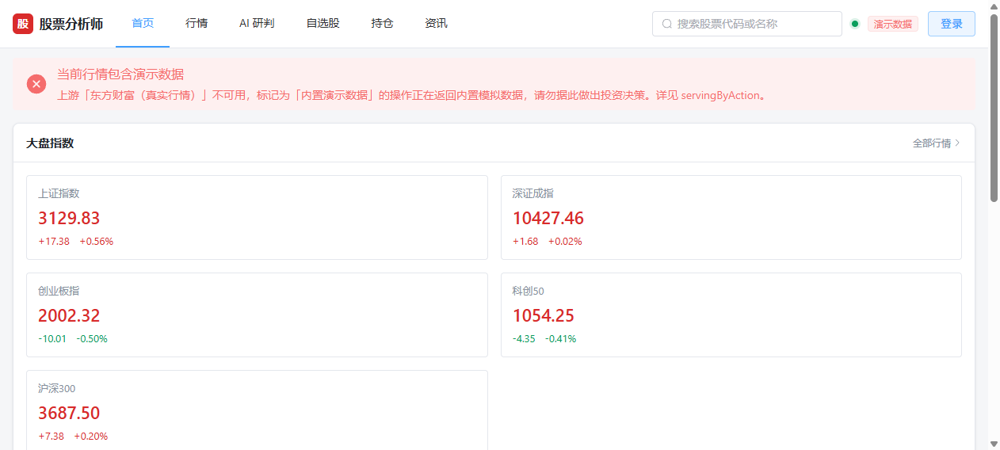
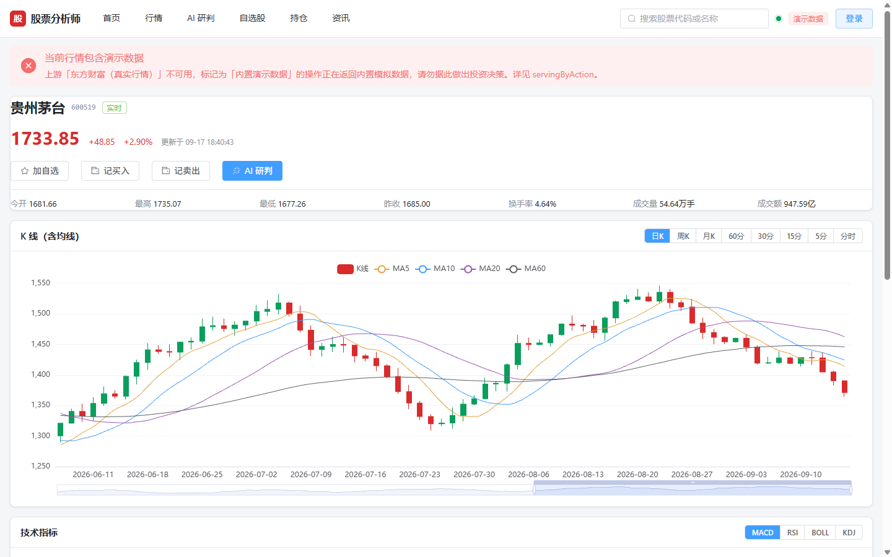
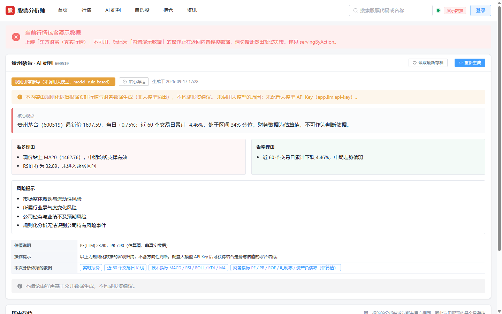
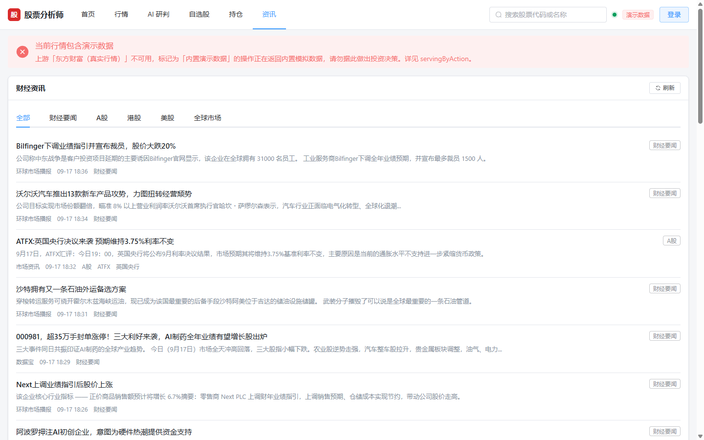
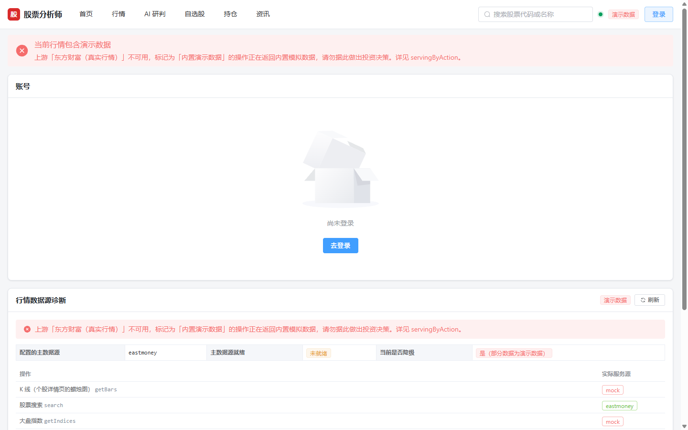
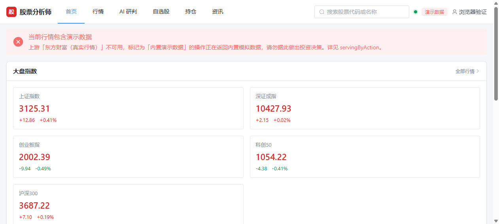
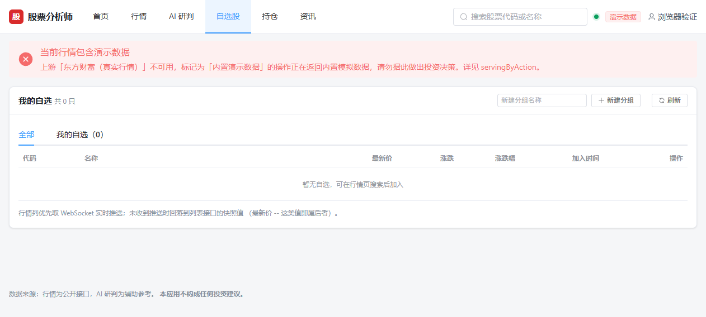
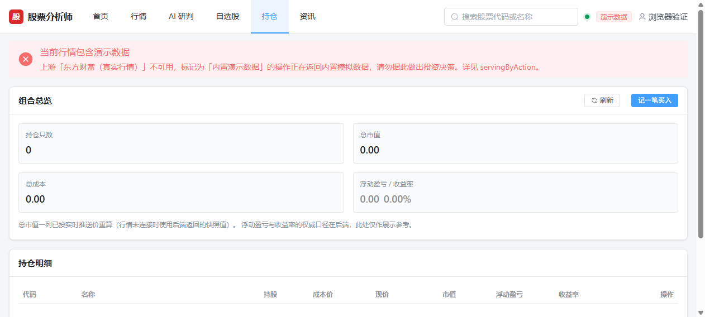

# 股票分析师（Java 版）

基于 `功能简介.md` 描述的功能，用 Java 技术栈重新实现的股票分析系统脚手架。
**PC 宽屏 Web 版**，不含移动端 App。

---

## 一、技术栈

| 层 | 选型 | 说明 |
|---|---|---|
| 后端框架 | **Spring Boot 4.1.1**（Spring Framework 7.0.9 / Tomcat 11） | 注意 4.x 的三处破坏性变更见下文 |
| 语言 / 构建 | Java 21 / Maven 3.9 | |
| 持久层 | **MyBatis-Plus 3.5.17**（`mybatis-plus-spring-boot4-starter`） | |
| 数据库 | **MySQL 8**（主）+ **H2 内存库**（开发兜底） | 双 profile |
| 缓存 | Caffeine（本地）+ Redis（可选） | 行情/资讯/限流 |
| 鉴权 | 双令牌 JWT（jjwt 0.13.0）+ 会话级吊销黑名单 | Access 30min / Refresh 30d |
| 实时推送 | 原生 WebSocket（非 STOMP）`/ws/quote` | 每 3 秒推送 |
| 限流 | 自研令牌桶 AOP（`@RateLimit`） | STRICT / LOOSE 双档 |
| 接口文档 | springdoc-openapi | `/swagger-ui.html` |
| 前端 | **Vue 3.5.43 + TypeScript 6.0.3 + Vite 8.3.0 + Pinia 4.0.3 + Vue Router 5.3.1** | 版本号已钉死，原因见下文 |
| UI / 图表 | **Element Plus 2.14.5 + ECharts 6.1.0** | |

### Spring Boot 4.x 的三个坑（本次实测踩到的）

1. `spring-boot-starter-web` → **`spring-boot-starter-webmvc`**
2. `spring-boot-starter-aop` → **`spring-boot-starter-aspectj`**
3. **Jackson 3**：databind/core 的包名从 `com.fasterxml.jackson` 改为 **`tools.jackson`**
   （`JsonNode.asText()` → `asString()`，且对非字符串节点会抛异常）。
   **但注解包 `com.fasterxml.jackson.annotation` 没有改名**，Jackson 3 仍读它，所以
   `@JsonInclude` / `@JsonIgnoreProperties` 不用改。这一点容易误判，本次已实测确认。

> 实测发现 classpath 上同时存在 `jackson-databind 3.1.5`（Spring MVC 用）与
> `jackson-databind 2.21.5`（`jjwt-jackson` 依赖）。业务代码中没有任何地方引用
> Jackson 2 的 databind，两套互不干扰；代价是 jar 里多约 2MB。若要清理，
> 可排除 `jjwt-jackson` 改用 `jjwt-gson`，或自行实现 jjwt 的 `Serializer`。

### 前端工具链的两个坑（本次实测踩到的，都会直接卡住构建）

**坑 1：`typescript` 不能取 latest —— 7.x 是 Go 原生移植版，与 `vue-tsc` 架构性不兼容。**

`typescript@7.0.2`（当前 npm `latest`）不再是 JavaScript 实现的编译器，而是 Go 原生版
（`tsgo`）：它的 `lib/tsc.js` 只有二十来行，作用是 `execFileSync` 拉起
`@typescript/typescript-win32-x64` 里的原生二进制；`exports` 映射里 `"."` 只导出
`version.cjs`（一个版本号字符串），**完全不暴露编译器 API**。

而 `vue-tsc` 必须调用 TypeScript 的 JS 编译器 API（`@vue/language-core` 生成虚拟
`.vue` 文件后交给 `ts.createProgram`）。因此报错是必然的：

```
Error [ERR_PACKAGE_PATH_NOT_EXPORTED]: Package subpath './lib/tsc' is not defined by
"exports" in node_modules/typescript/package.json
    at resolveTscPath (node_modules/vue-tsc/index.js:73:43)
```

`vue-tsc/index.js` 里确实留了一段 `@typescript/typescript6` 的桥接特判，但它依赖的
`@typescript/old` 包在 npm 上 **404，不存在**，那条路走不通。

**解法**：把 `typescript` 钉在最后一条 JS 编译器版本线 **`~6.0.3`**（`7.x` 已全面转向原生）。
`package.json` 中已按此固定。**升级 Vite / Vue 时不要顺手把 typescript 提到 7。**

**坑 2：Vite 8 的打包器是 rolldown，`manualChunks` 不再支持对象写法。**

Vite 8 底层已从 rollup 换成 **rolldown**。沿用手册里的经典写法会直接报类型错：

```ts
// ❌ TS2769 —— rolldown 的 manualChunks 只接受函数签名
manualChunks: { echarts: ['echarts'] }
```

rolldown 的官方文档明确写着 *"Note that unlike Rollup, object form is not supported"*。
等价写法是 `codeSplitting.groups`（用 `test` 正则匹配模块路径）。同时
`rollupOptions` 已是 deprecated 别名，新键名是 **`rolldownOptions`**。本脚手架已按新写法配置。


---

## 二、目录结构

```
gupiao/
├── backend/                     后端
│   ├── src/main/java/com/stocklab/analyst/
│   │   ├── common/              统一响应、异常、限流、缓存
│   │   ├── config/              配置类与 @ConfigurationProperties
│   │   ├── market/              行情数据源抽象（唯一允许调外部行情接口的地方）
│   │   │   ├── eastmoney/       东方财富实现（主数据源，真实行情）
│   │   │   ├── tencent/         腾讯行情实现（备用真实源：东财被风控时接管报价/K线/指数）
│   │   │   ├── mock/            内置演示数据源（链尾兜底）
│   │   │   └── fundamental/     财务数据客户端
│   │   ├── news/                新浪财经资讯客户端
│   │   ├── security/            JWT、会话黑名单、参数解析器
│   │   ├── ws/                  WebSocket 协议与会话注册表
│   │   └── modules/             业务模块
│   │       ├── auth/            注册 / 登录 / 刷新 / 登出 / 改密
│   │       ├── quote/           指数 / 报价 / K 线 / 搜索 / 数据源状态
│   │       ├── indicator/       MACD / RSI / BOLL / KDJ / MA
│   │       ├── fundamental/     PE/PB/ROE + 杜邦分析 + 财报
│   │       ├── watchlist/       自选股分组与条目
│   │       ├── holding/         持仓与盈亏
│   │       ├── news/            资讯
│   │       └── analysis/        AI 研判（大模型 + 规则引擎降级）
│   │           └── support/     分析协作者：取数 / 提示词 / 解析 / 兜底报告 / 存档（见 §6.12）
│   ├── src/main/resources/
│   │   ├── application.yml      主配置（敏感项全走环境变量）
│   │   ├── application-dev.yml  H2 内存库
│   │   ├── application-mysql.yml MySQL 8
│   │   └── db/migration/        Flyway 迁移脚本：{mysql,h2}/V1__baseline.sql
│   ├── src/test/java/.../       单元测试（373 项 / 20 个类，见 5.1）
│   ├── scripts/
│   │   ├── smoke-test.sh        冒烟测试（54 项断言，见第五节）
│   │   └── ws-check.mjs         WebSocket 协议验证脚本
│   └── Dockerfile
├── frontend/                    前端
│   ├── src/
│   │   ├── api/                 http.ts（令牌生命周期）/ endpoints.ts / types.ts
│   │   ├── stores/              auth / marketSource / quoteSocket
│   │   ├── components/          BaseChart / ChangeText / SourceBadge / TradeDialog
│   │   ├── layouts/             DefaultLayout
│   │   └── views/               9 个页面
│   ├── nginx.conf               生产静态托管 + 反向代理
│   ├── Dockerfile               多阶段：node 构建 → nginx 托管
│   └── .dockerignore            排除 node_modules/dist（**必须有**，原因见 §3.4）
├── deploy/                      一键起全栈：docker-compose.yml + .env.example + start/stop 脚本（**需在此目录下执行**）
├── docs/screenshots/            浏览器实测截图（见 5.4）
├── .github/workflows/ci.yml     三条流水线：单测 / 前端构建 / 冒烟+WS（未在 Actions 上跑过）
└── tools/mvn.sh                 Maven 包装（修 Git Bash 路径问题）
```

---

## 三、快速开始

### 3.1 后端（开发环境，H2 内存库，无需装数据库）

```bash
# 跑单元测试（373 项，不需要数据库，不占端口）
# 其中 19 项需要真 Redis，未提供时会逐条标记为跳过（Skipped: 19），不算失败
bash tools/mvn.sh -f backend/pom.xml -o test

# 若本机有 Redis，把地址传进去，这 19 项就会真跑
REDIS_HOST=127.0.0.1 REDIS_PORT=6379 bash tools/mvn.sh -f backend/pom.xml -o test

# 编译打包
bash tools/mvn.sh -f backend/pom.xml -o -Dmaven.test.skip=true package

# 启动
java -jar backend/target/stock-analyst-backend.jar --spring.profiles.active=dev --server.port=8080
```

- 健康检查：`http://localhost:8080/actuator/health`
- 接口文档：`http://localhost:8080/swagger-ui.html`
- H2 控制台：`http://localhost:8080/h2-console`
  （JDBC URL `jdbc:h2:mem:stockanalyst`，用户 `SA`，空密码）

> **`tools/mvn.sh` 是干什么的**
> 本机 Git Bash 设置了 `MSYS_NO_PATHCONV=1`，Maven 自带的 `bin/mvn` 会把 unix 风格
> 路径原样交给 `java.exe`，导致 `ClassNotFoundException: plexus-classworlds.launcher`。
> 该脚本绕过 mvn 脚本直接调用 classworlds 启动器，参数与 `mvn` 完全一致。

### 3.2 后端（MySQL）

```bash
export DB_HOST=localhost DB_PORT=3306 DB_NAME=stocklab
export DB_USERNAME=stockapp DB_PASSWORD='...'
export JWT_SECRET='至少 32 字符的随机串'   # 该变量没有默认值，缺失会启动失败
export LLM_API_KEY='...'                  # 可选，不配则 AI 分析降级为规则引擎

# 不需要手工建表：启动时由 Flyway 执行 db/migration/mysql/ 下的迁移脚本。
#   - 全新库      → 执行 V1__baseline.sql 建表
#   - 已有表的库  → baseline-on-migrate 打基线跳过 V1，**数据原样保留**
# 应用账号需要 DDL 权限（Flyway 要建 flyway_schema_history）；不允许时用
# spring.flyway.user / spring.flyway.password 指定独立迁移账号。
java -jar backend/target/stock-analyst-backend.jar --spring.profiles.active=mysql
```

> **为什么不再有 `schema-mysql.sql`**：原来「手工执行建表脚本」与「迁移工具」
> 两套机制并存时，建表脚本会把表先建出来、Flyway 只看到「结构非空」而打基线，
> 结果是**谁都没有真正管过结构演进**——这正是引入迁移工具要消灭的状态。
> 现在 DDL 的唯一归属是 `db/migration/`，`deploy/docker-compose.yml` 里那个
> 一次性的 `db-init` 容器也已一并移除。旧的 `schema-*.sql` 内容原样变成了
> `V1__baseline.sql`（`IF NOT EXISTS` 语句逐字节保留，以保证与既有表结构一致）。

### 3.3 前端

```bash
cd frontend
npm install

# 开发模式：http://localhost:5173，/api 与 /ws 自动代理到 :8080
npm run dev

# 单元测试（Vitest + jsdom）
npm run test          # 跑一遍退出
npm run test:watch    # 监听模式

# 类型检查（vue-tsc 查 src，tsc 查 vite.config.ts / vitest.config.ts）
npm run typecheck

# 生产构建 → dist/（先 typecheck 再 vite build）
npm run build

# 预览生产构建产物（同样带 /api 与 /ws 代理，用于联调）
npm run preview       # http://localhost:4173
```

后端不在默认 8080 时，改 `frontend/.env.development` 里的 `VITE_BACKEND_ORIGIN`；
临时覆盖可以直接内联环境变量：`VITE_BACKEND_ORIGIN=http://localhost:18080 npm run preview`。

### 3.4 全栈 Docker（一键启动）

> **⚠️ 必须先 `cd deploy`！** `docker-compose.yml` 放在 `deploy/` 子目录，不在项目根目录。
> Compose 默认只读「当前目录」下的 `docker-compose.yml` / `compose.yml`，在根目录直接跑会报
> `no configuration file provided: not found`。要么先切目录，要么用 `-f` 指定路径（见下）。

**方式一：一键脚本（推荐）**

- **Windows**：双击 `deploy\start.bat`（脚本内部会自动切到 `deploy` 目录）。
- **Linux / macOS**：

  ```bash
  cd deploy
  ./start.sh              # 首次自动生成 .env（随机 JWT_SECRET + 库密码）+ 构建 + 拉起
  ```

  脚本自动做四件事：① 从 `.env.example` 生成 `.env`（缺失的 `JWT_SECRET`、
  `MYSQL_ROOT_PASSWORD` 自动补随机值）；② 检查 Docker / Compose 插件；③ `docker compose up -d --build`
  拉起 MySQL + Redis + 后端 + 前端(Nginx)；④ 轮询 `/actuator/health` 直到后端就绪。

**方式二：手动命令**

> ⚠️ **不要用 `cp .env.example .env` 直接覆盖已有的 `.env`**。`.env.example` 里密钥是空值/占位符，
> 覆盖后会导致 `JWT_SECRET is missing`，且一旦 MySQL 容器已用旧密码初始化过，还会引发「密码分裂」
> （后端连库报 `Access denied for user 'root'@'...'`）。要生成带随机密钥的 `.env`，请用 `init-env.bat`/`init-env.ps1`。

```bash
cd deploy
# 若 .env 不存在，先双击 init-env.bat 生成（会自动填随机密钥），不要手动 cp
docker compose up -d --build
```

  不想手填密钥时，Windows 可双击 `init-env.bat`（Linux/macOS 跑 `powershell -File init-env.ps1`
  或 `./start.sh` 只生成不启动），它会自动生成带随机密钥的 `.env`。

  或保持在项目根目录，用 `-f` 显式指定配置文件（二选一即可）：

```bash
docker compose -f deploy/docker-compose.yml up -d --build
```

**访问入口**：`http://localhost:8088`（前端，Nginx 反代后端）；后端健康检查 `http://localhost:18080/actuator/health`。

> 端口说明：前端宿主 8088、后端宿主 **18080**（8080 被 Docker Desktop/WSL 自身占用）、MySQL 宿主 **3307**（3306 被本机 MySQL 占用）。这些是宿主端口；容器间走内部网络（`backend:8080`、`mysql:3306`），与宿主端口无关。可在 `.env` 里改 `FRONTEND_PORT` / `BACKEND_PORT` / `MYSQL_PORT` 覆盖。

**停止**：`cd deploy && ./stop.sh`（Windows `stop.bat`）；数据卷默认保留，加 `--volumes` 才会清库。

#### 常见报错速查

| 报错 / 现象 | 原因 | 处理 |
|---|---|---|
| `no configuration file provided: not found` | 在**非 `deploy` 目录**（如项目根目录）执行 `docker compose` | 先 `cd deploy`，或 `docker compose -f deploy/docker-compose.yml ...` |
| `required variable JWT_SECRET is missing a value` / `variable MYSQL_ROOT_PASSWORD is not set` | 缺 `.env` 文件（只切了目录，还没生成 `.env`） | 双击 `start.bat`（自动生成），或 `copy .env.example .env` 后手动填，或双击 `init-env.bat` |
| 后端容器反复重启，日志含 `JWT_SECRET` | `JWT_SECRET` 未设置（compose 里 `:?` 必填） | 用 `start.sh` 自动生成，或手动在 `.env` 里填 `JWT_SECRET=<64位随机串>` |
| 后端启动即报 `Communications link failure` | MySQL 未就绪就连接（偶发） | compose 已用 `depends_on: service_healthy` + `wait_timeout=28800` 规避；重启 `docker compose restart backend` 即可 |
| 前端页面能开但接口 502 | 后端未就绪，Nginx 反代 `backend:8080` 连不上 | 先确认后端健康 `http://localhost:18080/actuator/health`，再看 `docker compose logs -f backend` |
| `Bind for 0.0.0.0:3306 failed: port is already allocated` | 本机已有 MySQL 占用 3306 | 已改用宿主 3307（`.env` 里 `MYSQL_PORT` 可改） |
| `Bind for 0.0.0.0:8080 failed: port is already allocated` | Docker Desktop(WSL2) 自身占用宿主 8080 | 已改用宿主 18080（`.env` 里 `BACKEND_PORT` 可改） |
| `Unsupported character encoding 'utf8mb4'` | JDBC URL 里 `characterEncoding` 用了 MySQL 字符集名 | 已改为 `characterEncoding=UTF-8`（Java 字符集名） |
| 后端启动报 `Can't connect to MySQL (111)` | MySQL 8 镜像首次启动先起临时 server 初始化，healthcheck 过早放行 | compose 已用 `depends_on: service_healthy` 规避；偶发时等 MySQL healthy 后 `docker compose restart backend` |
| 后端启动报 `Access denied for user 'root'@'...'` | **MySQL 密码分裂**：`.env` 的 `MYSQL_ROOT_PASSWORD` 被改过（如手动 `cp .env.example .env` 覆盖），但 MySQL 数据卷里还是旧密码 | 删数据卷重建：`docker compose down && docker volume rm deploy_mysql-data && docker compose up -d`（会清空库，仅测试数据时安全） |
| 页面样式正常但体积没变化 / 改了前端却看不到效果 | **部署镜像是旧的**：`docker compose up -d --build` 只重建镜像，**不会自动在你改代码后重跑**；用 `--build` 漏掉或改了代码没重建都会如此 | 先 `cd deploy && docker compose up -d --build`，再按下面的「怎么确认部署真的是最新」核对产物字节数 |
| 构建卡在 `mvn dependency:go-offline` 或 `npm ci` | 首次拉依赖，受网络影响 | 属正常首次构建耗时；耐心等待，或配置镜像加速 |

#### 怎么确认「部署的真的是最新构建」（别只看镜像时间）

**判定依据是产物字节数 / 哈希，不是镜像构建时间。** 这一条是踩过坑才写下的：
镜像"看起来刚构建过"（`docker images` 显示 `26 minutes ago`），但里面装的仍是
改造前的产物 —— 因为那次重建发生在源码改动**之前**（为另一处改动而跑）。

```bash
# ① 本地刚构建出的产物
cd frontend && npm run build
ls -l dist/assets | grep -E 'element|echarts'

# ② 部署容器里的产物
docker exec stocklab-frontend ls -l /usr/share/nginx/html/assets | grep -E 'element|echarts'

# ③ 8088 实际返回的字节数（最终以这条为准）
curl -s http://localhost:8088/ | grep -o '/assets/[A-Za-z0-9_-]*\.\(js\|css\)'
curl -sI http://localhost:8088/assets/element-XXXX.js | grep -i content-length
```

三者必须一致。以本轮改造后的实测值为基准：

| 产物 | 改造前 | 改造后（当前应为这个） |
|---|---|---|
| `element-*.js` | 985,775 B | **591,615 B** |
| `element-*.css` | 359,988 B | **201,513 B** |
| `echarts-*.js` | 1,117,148 B | **579,243 B** |

**两个容易误判的地方**：

1. **时区**：`docker images` 的 `CreatedSince` 是本地时区，而 `docker inspect` 的
   `.Created` 是 UTC。拿源码 mtime 去比时**先统一时区**——本项目用 `toISOString()`
   读出的源码时间是 UTC，曾因此把「改动晚于镜像」误判成「改动早于镜像」。
2. **容器用的是不是最新镜像**：`docker ps` 只显示 tag 名，比不出来。要比 ID：

   ```bash
   docker inspect stocklab-frontend --format '{{.Image}}'
   docker inspect deploy-frontend:latest --format '{{.Id}}'
   ```

   两者相等，才是真的用上了刚构建的镜像。

#### 为什么 `frontend/.dockerignore` 不能删

`frontend/Dockerfile` 第一阶段是 `COPY package.json package-lock.json* ./` + `npm ci`，
之后 `COPY . .`。**没有 `.dockerignore` 时，第二条 COPY 会把宿主机的 `node_modules`
整个盖到容器里刚装好的依赖树之上**：

- 宿主机（Windows / macOS）装的 esbuild / rolldown 原生二进制属于 `win32-x64` /
  `darwin-arm64`，与容器内的 `linux-x64` 版本并存——现在能跑对只是因为 Node 按
  `process.platform` 解析，属于"碰巧没事"，不是有保证的行为；
- 更实质的风险是 **`npm ci` 的「按锁文件精确还原」被架空**：COPY 会覆盖同名文件，
  宿主机 `node_modules` 若与 `package-lock.json` 不同步，构建就用宿主机那一份。

`backend/Dockerfile` 用的是 `COPY src ./src`（显式指定目录），不受此影响，因此后端不需要。

---

## 四、接口清单

统一前缀 `/api/v1`，统一响应体 `{ code, message, data }`。`code` 为业务码
（如 `AUTH_EXPIRED`），与 HTTP 状态码各司其职。

### 鉴权 `/auth`

| 方法 | 路径 | 说明 |
|---|---|---|
| POST | `/auth/register` | 注册并直接返回令牌对 |
| POST | `/auth/login` | 登录 |
| POST | `/auth/refresh` | 刷新令牌（轮转，旧 refresh 立即失效） |
| POST | `/auth/logout` | 登出，**吊销整个会话**（body 可省略） |
| GET | `/auth/me` | 当前用户 |
| POST | `/auth/password` | 改密 |

### 行情 `/quote`（公开只读）

| 方法 | 路径 | 说明 |
|---|---|---|
| GET | `/quote/indices` | 大盘指数 |
| GET | `/quote/movers?metric=&order=&limit=` | 市场榜单：涨幅榜 / 跌幅榜（`metric=changePct&order=asc`）/ 成交额榜 |
| GET | `/quote/carousel?count=` | 首页精选（1~8） |
| GET | `/quote/search?q=` | 全市场检索（**中文需 URL 编码**） |
| GET | `/quote/source` | 数据源状态（含 `degraded` 与降级明细） |
| GET | `/quote/{code}` | 实时报价 |
| GET | `/quote/{code}/bars?period=&limit=&start=&end=` | K 线 |

**行情降级链（2026-09-21 起）**：`eastmoney → tencent → mock` 三级，逐次调用独立路由：

- 东财存在 **IP 级风控**（服务端直接断连，`HTTP/1.1 header parser received no bytes`，
  2026-09-19 / 09-21 两次实测连 curl 都被掐）。触发时报价 / K 线 / 指数由
  **腾讯行情（qt.gtimg.cn，真实数据）** 继续服务，`degraded` 保持 `false`——
  真实行情不该挂「演示数据」警示；实际服务方看 `/quote/source` 的 `servingByAction`。
- 搜索与榜单是东财独有能力（腾讯无对应接口），落 mock 演示数据，此时 `degraded=true`。
- 每级真实源失败后进入 **30 秒冷却**（`app.market-data.upstream-cooldown`，可配 0s 关闭），
  冷却按「操作 × 数据源」隔离——报价被风控不会连累本可正常服务的 K 线。
- 恢复是自动的：冷却到期放行探测，成功即回到主源。

### 技术指标 `/indicator`

| 方法 | 路径 | 说明 |
|---|---|---|
| GET | `/indicator/{code}?indicators=&limit=` | 参数名是 **`indicators`**；可选 MACD/RSI/BOLL/KDJ/MA |

### 基本面 `/fundamental`

| 方法 | 路径 | 说明 |
|---|---|---|
| GET | `/fundamental/{code}` | PE/PB/ROE/毛利率等，含 `dataSource` |
| GET | `/fundamental/{code}/dupont` | 杜邦分解（三项相乘 = ROE） |
| GET | `/fundamental/{code}/statements?periods=` | 财报多期 |
| GET | `/fundamental/compare?codes=` | 同行对比，**最多 6 只** |

### 自选股 `/watchlist`（需登录）

`GET/POST /watchlist/groups`、`DELETE /watchlist/groups/{groupId}`、
`GET/POST /watchlist/items`、`DELETE /watchlist/items/{itemId}`

### 持仓 `/holdings`（需登录）

`GET /holdings`、`GET /holdings/summary`、`POST /holdings/buy`、
`POST /holdings/sell`、`DELETE /holdings/{code}`

买入支持**从全市场选股**（买入弹窗搜索联想，行情页搜索结果与个股详情页也有入口）
与**买入日期**（`buyDate`，`YYYY-MM-DD`，可补录历史，缺省当天）；
持仓市值/盈亏随行情实时变动（REST 快照 + WebSocket 推送重算）。
`holdings.buy_date` 列：新库由建表脚本自带；已部署的老库需手动
`ALTER TABLE holdings ADD COLUMN buy_date VARCHAR(10) NULL AFTER avg_cost`。

### 资讯 `/news`

`GET /news/list?channel=&limit=`、`GET /news/channels`
（channel 可选 `all` / `finance` / `a-shares` / `hk` / `us` / `global`）

### AI 研判 `/analysis`

`GET /analysis/{code}`（优先返回存档）、`POST /analysis/{code}`（强制重生成）、
`GET /analysis/{code}/history`

### WebSocket `/ws/quote`

```
上行 → {"action":"subscribe","codes":["600519"]}
     → {"action":"unsubscribe","codes":["600519"]}
     → {"action":"ping"}
下行 ← {"type":"ready","msg":"connected to /ws/quote"}
     ← {"type":"subscribed","codes":[...],"snapshots":[...],"rejected":[...]}
     ← {"type":"quote",...}                          每 3 秒
     ← {"type":"pong","ts":1789635005}
     ← {"type":"error","code":"600519","message":"..."}
```

两条容易踩的约定：
- **时间戳一律 epoch 秒**（含 DB、REST、WS）；唯一例外是 AI 报告的 `generatedAt`（ISO-8601）
- **`subscribed.codes` 是订阅后的完整集合，不是本次新增项**

---

## 五、验证状态

### 5.1 已验证通过（可复跑）

| 项 | 复跑命令 | 实测结果 |
|---|---|---|
| 后端单元测试 | `bash tools/mvn.sh -f backend/pom.xml -o test` | **373 项**：实跑 **354 项全通过** + **19 项跳过**（本机无 Redis），0 失败 / 0 错误，`BUILD SUCCESS` |
| 后端接口冒烟 | `BASE=http://localhost:18080 bash backend/scripts/smoke-test.sh` | **54 项断言全通过**，退出码 0（含市场榜单 4 条新断言）；榜单功能实装后重新打包实跑过 |
| WebSocket 协议 | `node backend/scripts/ws-check.mjs ws://localhost:8080/ws/quote` | **12 项断言全通过** |
| 前端单元测试 | `cd frontend && npm run test` | **7 项全通过**（`marketSource` store：不可达 / 降级 / 未就绪 / 正常四态 + 恢复后清除） |
| 前端类型检查 | `cd frontend && npm run typecheck` | **0 错误**（`vue-tsc` + `tsc` 两份配置各查一遍） |
| 前端生产构建 | `cd frontend && npm run build` | **2386 个模块**，产出 `dist/`；体积对比见 §5.4 |
| 前后端联调 | 见 5.4 | 静态托管 / SPA 回退 / `/api` 代理 / `/ws` 代理 全部实测通过 |
| 浏览器端到端 | 见 5.4 | 5 个页面 + 注册登录链路实测，**JS 运行时错误 0** |
| CI 流水线 | `.github/workflows/ci.yml` | 三个 job 已配置（`backend-unit` / `frontend-build` / `integration`），两个带 `services.redis`，含 **3 处防「假绿」守卫**；**未在真实 GitHub Runner 上跑过**（本机无 Actions 环境） |
| 真 Redis 集成测试 | `REDIS_HOST=127.0.0.1 mvn test` | 本机无 Redis，**19 项明确 SKIP**；CI 由 `services.redis` 提供实例后应全跑（见 5.3） |

> **关于端口**：单元测试不启动 Spring 容器，不占端口。冒烟与 WS 两项需要后端在跑，
> 本次是在 `--server.port=18080`（避开本机 `SERVER__PORT` 环境变量干扰）下实跑的，
> 命令中的 8080 是脚手架默认端口，换端口时用 `BASE=` 覆盖即可。

> **冒烟测试里的公网依赖**：50 项中有 2 项（中文搜索、资讯 feed）必须访问真实上游接口。
> 公网受限时用 `SKIP_UPSTREAM=1` 运行，这 2 项会计入 **SKIP 而不是 PASS**，
> 汇总会显示「通过 48 项，失败 0 项，跳过 2 项」并额外打印一行告警。
> **跳过就是跳过，不算通过**——这是有意的，避免「测试是绿的但其实没测到」。
> CI 里的 `integration` job 会先探测上游可达性再自动决定用哪种模式。

覆盖内容：健康检查、指数/报价/K线/搜索/数据源状态、技术指标（含非法指标与越界）、
资讯（含非法频道）、基本面（含 compare 上限）、鉴权全链路（注册/重复注册/密码校验/
登录/伪造令牌/无令牌/令牌类型校验/**登出后 access 与 refresh 同时失效**/
**仅凭 refreshToken 登出（无 Authorization 头）也让 access 失效**/登出幂等）、
自选股（懒创建分组/重复/非法代码）、持仓（买入/补仓加权成本=1250/卖出/超量卖出/汇总）、
AI 分析（降级标注/存档命中/历史/非法代码）、WS 统计。

#### 单元测试明细（400 项）

JUnit 5 + AssertJ + Mockito，`spring-boot-starter-test` 已含，全部为 test scope，不引额外依赖。

> **下表的项数取自 Surefire 报告实测**（数 `<testcase>` 元素，不读 `<testsuite tests>` 属性——
> 同一个结果集后者会少算，见 §5.3.1 ①）。此前有两行的项数是过时的，已按实测修正；
> `QuoteServiceTest` 更是从来没被列进来过。

| 测试类 | 项数 | 分布（`@Nested`） |
|---|---|---|
| `ResilientMarketDataProviderTest` | 51 | 主数据源正常、降级、查无此股、关闭降级、市场榜单、与真实演示源协作、对外元信息、多级降级链与冷却、**拒绝编造降级数据**（本轮新增 6 项，见 §6.12） |
| `WatchlistServiceTest` | 50 | 分组列表与懒创建 10、列出条目 11、添加条目 13、创建分组 7、删除分组 4、删除条目 4、常量契约 1 |
| `AuthServiceTest` | 39 | 注册 7、登录 6、刷新令牌 9、登出 8、当前用户 2、修改密码 5、日志脱敏 2 |
| `IndicatorCalculatorTest` | 32 | ma 简单移动平均 4、ema 3、sma 通达信口径 2、macd 3、boll 6、kdj 5、rsi 6、toList 3 |
| `RedisTokenBucketRateLimiterTest` | 25 | 发给 Redis 的参数 6、键设计 4、脚本返回值解析 12、Redis 故障 3 |
| `HoldingServiceTest` | 25 | 买入与补仓 9、查询与组合总览 5、卖出 5、并发首次买入 2、删除持仓 2、名称解析 2 |
| `RedisTokenRevocationStoreTest` | 19 | 键与 TTL 5、不该写入的情况 3、查询 6、Redis 故障 5 |
| `RateLimitAspectTest` | 18 | 切入点织入 4、放行与拦截 6、客户端标识解析 8 |
| `InMemoryTokenBucketRateLimiterTest` | 17 | 容量与拒绝 3、隔离 3、补充 2、并发 2、回收空闲桶 2、stats 1、配置默认值 4 |
| `TencentMarketDataProviderParseTest` | 15 | 实时报价、日/周/月 K 线、分时、指数（样本均为真实上游响应） |
| `LlmJsonParserTest` | 12 | 三级降级解析 6、围栏剥离 2、字段读取 4（**本轮新增**） |
| `RedisTokenBucketRateLimiterRedisTest` ⚑ | 11 | 令牌扣减 4、多实例共享配额 2、键隔离与回收 4、令牌补充 1 |
| `PromptBuilderTest` | 11 | 数据齐全 4、数据缺失 3、数据可信度 4（**本轮新增**） |
| `RuleBasedReportGeneratorTest` | 11 | 数据可信度约束 3、缺数时的措辞 3、由数据推导的结论 2、元信息 3（**本轮新增**） |
| `AnalysisServiceOrchestrationTest` | 9 | 存档命中与强制刷新 3、校验与失败路径 4、大模型成功与历史 2（**本轮新增**，编排分支判定） |
| `JwtTokenServiceTest` | 9 | 签发与解析往返 3、校验失败的错误码映射 5、构造期防线 1（**本轮新增**，能力边界） |
| `AuthControllerValidationTest` | 9 | 注册校验 3、登录校验与防用户枚举 2、通用异常映射 4（**本轮新增**，standalone MockMvc 切片） |
| `QuoteServiceTest` | 9 | 轮转切片：相邻批次零重合 7、空池兜底等 2（**只测轮播**——`QuoteService` 没有缓存层，见 §7.7） |
| `AsyncConfigTest` | 8 | 基本参数 4、饱和时的行为 2、关闭语义 2 |
| `RedisTokenRevocationStoreRedisTest` ⚑ | 8 | 跨实例可见性 4、过期 2、登出流程形状 2 |
| `MockMarketDataProviderMoversTest` | 5 | 涨幅降序 1、跌幅升序 1、成交额榜 1、limit 收敛 1、条目身份 1 |
| `EastMoneyMoversParseTest` | 4 | 真实样本解析 1、data:null 拒绝形态 1、非 6 位代码过滤 1、`"-"` 容错 1 |
| `MoverMetricParseTest` | 3 | 小驼峰参数 1、枚举名形态 1、非法与空值 1 |

> ⚑ = 需要真 Redis。未提供时这 19 项会**逐条标记为跳过**（不是失败、也不是静默消失），
> 在 Surefire 汇总里如实显示 `Skipped: 19`。

**选测试对象的判据不是「哪个重要」，而是「哪个失效时不会报错」**：
指标口径偏一点、成本算错一分钱、限流悄悄放行、登出只吊销一半、
越权防护少写一个 `user_id`、Redis 故障时静默放行——
这些情况接口全都照样返回 200，日志里一行 ERROR 都没有，只能靠断言发现。
反过来，会在第一时间抛异常的功能（建表少了字段、Bean 装配不上）不需要靠单测发现。

`AuthServiceTest` 里**只 Mock 了 `UserMapper`**，`JwtTokenService` 与
`TokenRevocationStore` 用真实实现。这是有意的：Mock 掉它们等于把
「令牌里到底有没有 `sid` 声明」这类**本测试真正要验证的东西**假设成对的，
断言会退化成「我调用了我自己设的桩」。用真实 JWT 才能断言
「access 与 refresh 共享同一个 sid」这种跨组件一致性约束——而那是登出能生效的前提。

指标测试里有一条**独立重写的朴素滑动窗口参照实现**（`naiveMa`，双层循环逐点求均值），
用来和被测的增量维护实现逐点比对——不是「照着实现再抄一遍断言」，否则恒等式毫无意义。
另外几条断言是**反向**的，专门锁住口径：

- `sma` 明确断言**不等于**简单均值（通达信 `SMA` 是递推平滑 `Y[i]=(X[i]+(N-1)Y[i-1])/N`）
- BOLL 明确断言**不是**样本标准差（通达信按总体标准差，除以 `N` 而非 `N-1`）
- `ma` 与 `boll.mid()` 两条独立代码路径必须给出完全相同的序列

还有一条**特征化测试** `flatSeriesCurrentlyGives100`：固化「横盘时 RSI 返回 100（极端超买）」
这一现状。它不是断言「这是对的」，而是断言「当前就是这样」——将来若改 RS 分母口径，
这条会红，逼开发者显式确认这是有意变更而不是手滑。
`AuthServiceTest` 里也有一条同类：`changePasswordDoesNotRevokeExistingTokens`
固化「改密不踢掉其他设备」这一**已知未实现**的边界。

限流器测试里最有价值的两条是**并发**那组：16 线程各发 4 次（共 64 次）去抢 20 个令牌，
断言**恰好放行 20 个**。`Bucket.tryAcquire` 的注释写着用 `synchronized` 保证
「补充 + 扣减」的原子性，但注释不是证据——把同步去掉，放行数会超过容量，
而这类 bug 在单机低并发下永远不会暴露。

> **测试里的时间依赖是有意的妥协**：桶补充只能靠真实 `Thread.sleep` 验证，
> 所以断言刻意写成**区间**（如「睡 500ms @ 10/s 应补回 1~40 个」）而不是精确值。
> 区间下界排除「根本没补」，上界远离容量上限，从而排除「一次补满」——
> 后者会让令牌桶退化成永久赦免。

> **一次 JVM 预热带来的 6.6× 提速**：`AuthServiceTest` 最初有一条用例耗时 2~4 秒，
> 而其余 38 条都在 0.2 秒内。逐步骤插桩后定位到根因是**一次性 JVM 冷启动成本**：
>
> | 操作 | 冷启动 | 预热后 | 倍差 |
> |---|---|---|---|
> | `new TokenRevocationStore()` | 171 ms | 1.1 ms | 155× |
> | `login`（签发两张 JWT） | 638 ms | 3.5 ms | 182× |
> | `logout` | 98 ms | 5.2 ms | 19× |
>
> 成本来自 jjwt 的算法 provider 反射查找、Caffeine 的 scheduler 与节点类初始化、
> `SecureRandom` 首次播种。它只发生一次，但会被记在**首个跑到该路径的用例**头上。
> 补了 `@BeforeAll` 预热（必须真实走到 `put`/`read` 路径，只 `new` 一个对象没用）后，
> 该类总耗时 **5.489s → 0.828s**，最慢单条 **2.058s → 0.303s**。
> 预热不减少总耗时，价值是让单条用例的耗时**可读**——否则将来有人加 `@Timeout`
> 会去追查一个并不存在的慢操作。

### 5.2 未能验证的部分（如实说明）

| 项 | 原因 | 影响 |
|---|---|---|
| 真实行情链路（2026-09-19 起加剧） | 上游开始**按客户端 TLS 指纹拦截**：同一请求，`curl` 带浏览器 UA 拿到完整数据，JDK `HttpClient` 则在 TLS 握手后被**静默断连**（`HTTP/1.1 header parser received no bytes`，一个字节不回、不报错） | 后端所有行情能力触发降级兜底（`/quote/source` 如实显示 `degraded: true`）。这不是代码缺陷——同一段代码在 09-17 拿到过真实行情。**恢复时无需改代码**：路由器每次调用都会重试主源，上游放行即自动切回真实数据 |
| 真实行情链路：**报价** | `push2.eastmoney.com/api/qt/stock/get` 连续 3 轮实测均 **HTTP 000** | 报价走降级数据源。**代码路径本身未被证伪，但也未被真实验证** |
| 真实行情链路：**K 线 / 指数** | 同一主机（`push2his` 的 `kline/get`、`push2` 的 `ulist.np/get`）在 3 轮里**各有一轮返回 200**，其余轮次 000 | **可达性是间歇的，不是"整体不可达"**。同一份代码有时拿真实行情、有时拿降级数据，取决于调用那一刻 |
| MySQL profile 实跑 | 依赖本机 MySQL 实例与建表，本次未启动 | SQL 语法与索引设计未经真实 MySQL 执行 |
| Docker Compose 起栈 | **已实跑通过**（2026-09-21）：`docker compose up -d --build` 拉起 MySQL+Redis+后端+前端，后端 `/actuator/health` 返回 UP、Hikari 连接池连上 MySQL、前端 8088 可访问、行情源 eastmoney 预热成功 | 实跑中修复了 4 个 compose 与后端配置不一致的缺陷（见 §5.2 与 memory 2026-09-21） |
| 真实大模型输出 | 未配置 `app.llm.api-key` | AI 研判走规则引擎（`model=rule-based`），**大模型调用链路未被真实验证** |
| 真 Redis 行为（19 项） | 本机既无 `redis-server`/`redis-cli`，Docker 守护进程也未运行 | **限流的 Lua 脚本本身**与**会话吊销的跨实例可见性**在本机只被标记为 `Skipped`，没有执行证据；CI 侧已配 `services.redis` 但同样未跑过（见第七节第 9/10 条） |

> **这一节和 §5.3 的分工**：这里只列「完全拿不到环境、因此一行都没跑」的几项；
> §5.3 那张矩阵覆盖全部生产级能力，包括「已实现但只有部分证据」的 ⚠️ 项。

> **关于「上游不可达」的精确说法**：上一版 README 写的是「对 `push2` 与 `push2his`
> 均不可达」，那是**把某一时刻的快照当成了稳定结论**。实测后修正为：
> 不可达是**按路径、且间歇**的——
>
> | 主机 + 路径 | 用途 | 实测（3 轮） |
> |---|---|---|
> | `push2/api/qt/stock/get` | 实时报价 | 000 / 000 / 000（稳定不可达） |
> | `push2his/api/qt/stock/kline/get` | K 线 | 000 / **200** / 000 |
> | `push2/api/qt/ulist.np/get` | 指数 | **200** / 000 / 000 |
> | `searchapi/api/suggest/get` | 搜索 | 稳定 200 |
> | `datacenter-web/api/data/v1/get` | 基本面 | 稳定 200 |
>
> 这个修正不只是措辞问题：跑冒烟时抓到的实时状态是
> `servingByAction = {"getIndices":"eastmoney", "search":"eastmoney",
> "getQuote":"mock", "getBars":"mock"}` ——
> **同一个进程里，指数走了真实源、报价走了降级源**。
> 这恰好从生产行为上证明了「按操作粒度记录数据来源」是必要的：
> 如果只有一个全局 `degraded` 布尔，这种「一半真一半假」的状态根本表达不出来。
>
> 关于降级时的界面表现：`/quote/source` 返回 `degraded: true` 并给出 `notice`，
> 前端顶栏展示红色「演示数据」徽标与全局告警条。**界面不会把模拟价格
> 标成真实行情**——这条在本次修复前是不成立的（见第六节第 10 条）。

### 5.3 生产就绪度矩阵

这张表的用途是**把「代码里写了」和「验证过能用」分开**。
前一版 README 把两者混在一起讲，结果是「多实例限流」「分布式会话」听起来都做了，
实际上一个没测过、一个压根没实现。下面每一项都给出证据出处或明确写出差距。

**图例**：✅ 已实现且有可复跑证据 ｜ ⚠️ 已实现但未验证 / 有已知边界 ｜ ❌ 明确未实现

| 能力 | 现状 | 证据 / 差距 |
|---|---|---|
| 限流（单机令牌桶） | ✅ | `InMemoryTokenBucketRateLimiterTest` 17 项，含 16 线程抢 20 个令牌的并发断言 |
| 限流（Redis 分布式） | ✅ | 分三层验证：**Java 侧换算与解析** 25 项；**Lua 脚本本身** 11 项（本机无 Redis 故跳过）；**整条 HTTP 栈** 由 CI 的 `integration` job 以 `RATE_LIMIT_STORE=redis` 跑完 50 项冒烟 |
| 限流切面（注解是否真生效） | ✅ | `RateLimitAspectTest` 18 项；其中 4 项用 `AspectJProxyFactory` **真实织入代理**，验证的是「切入点确实匹配到了方法」，而不是「直接调 `around()` 能跑」 |
| 会话吊销（单机） | ✅ | `AuthServiceTest` 39 项间接覆盖；`AuthService#logout` 只吊销一半的缺陷已修（第六节第 9 条） |
| 会话吊销（多实例） | ⚠️ | `RedisTokenRevocationStore` 已实现 + 19 项 Java 侧测试；**跨实例可见性的 8 项需真 Redis**（本机跳过）。`app.session.store` **默认仍是 `memory`**，未改默认值 |
| 登出是否真正生效 | ✅ | 冒烟测试 4 条断言：登出后 access 与 refresh 同时失效，含「仅凭 refreshToken 登出」 |
| 行情降级与错误分界 | ✅ | `ResilientMarketDataProviderTest` 32 项，含「查无此股绝不降级」6 项 |
| 越权防护（自选股） | ✅ | `WatchlistServiceTest` 50 项，断言**真实 SQL 片段与参数**含 `user_id`；另做过变异验证（见下） |
| 线程池语义 | ✅ | `AsyncConfigTest` 8 项：有界队列、`CallerRunsPolicy` 不丢任务、优雅停机等待 |
| 异步扇出（分析取数三路并发） | ⚠️ | 代码已实现（3 × `CompletableFuture.supplyAsync` + 逐路兜底），已抽到 `AnalysisInputLoader`，但**仍无单测**（它是 Spring Bean，测它要搭三个依赖的替身；判据上它属于「坏了会报错」那一类，优先级低于纯逻辑） |
| **异步 AI 生成** | ❌ | **明确未实现**：`AnalysisService#fromLlm` 在**请求线程上同步等待**至 `app.llm.timeout`（默认 45s），无任务队列、无 `taskId`、无回执。已把现状与改造落点写进类注释 |
| **WS 鉴权** | ❌ | **有意不做**，且已论证：`/ws/quote` 只推公开行情，不涉及用户数据。改造方案（先调 REST 换一次性 ticket 再握手，避免把长效 token 放进 query）写在 `QuoteWebSocketHandler` 类注释里 |
| MySQL profile | ✅ | **已实跑**（2026-09-24）。两条路径都验过：① 空库 → Flyway 执行 V1 建表，注册/登录/自选股可用；② **既有库升级 → `baseline-on-migrate` 打基线跳过 V1，`users`/`holdings`/`ai_reports`/`watchlist_groups` 行数与升级前逐条一致**（数据未丢），`flyway_schema_history` 记录 `type=BASELINE, success=1` |
| Docker Compose | ✅ | **已实跑通过**（2026-09-21，2026-09-24 复跑）。拉起 4 容器，后端健康 UP、连上 MySQL、前端可访问。实跑修复了变量名不一致（`JWT_SECRET`→`APP_JWT_SECRET`、`DB_URL`、`SPRING_DATA_REDIS_*`）、JDBC `characterEncoding=utf8mb4`→`UTF-8`、宿主端口冲突（3306/8080 被占→改 3307/18080）、db-init 时序竞态 4 类缺陷。**2026-09-24 复跑发现并修掉两个部署缺陷**：前端缺 `.dockerignore` 导致宿主机 `node_modules` 覆盖容器依赖树；以及「改了代码没重建镜像 → 部署仍是旧产物」（判定方法与基准字节数见 §3.4） |
| 真实大模型输出 | ⚠️ | 未配置 `LLM_API_KEY`，走规则引擎；**大模型调用链路未被真实验证** |
| 真实行情链路 | ⚠️ | 上游 `push2` / `push2his` 本机不可达，报价与 K 线走降级数据源 |
| CI | ⚠️ | 三个 job 已配置、YAML 结构经解析校验，**未在真实 GitHub Runner 上跑过** |
| 前端交互路径 | ⚠️ | 类型检查 / 生产构建 / 浏览器 5 个页面实跑已验证；另有 7 项 Vitest 覆盖数据源状态 store。更复杂的交互路径未逐一覆盖 |

#### 5.3.1 这套验证是怎么落到实处的

**① 跳过了多少，必须看得见。**

真 Redis 测试在连不上 Redis 时会跳过。跳过本身是对的（缺环境不是代码问题），
但「跳过」极易退化成「假装测过」。所以做了两件事：

- 探测放在 `@BeforeAll`（不抛假设），**跳过下沉到每个用例的 `@BeforeEach`**。
  一开始写在了 `@BeforeAll`，结果整个类被判定为 aborted，
  Surefire 只报 `Tests run: 0, Skipped: 0`——**跳过原因一行都不打印**，
  统计里连这个类都看不见。下沉之后汇总如实显示 `Skipped: 19`。
- CI 里加了一条**守卫步骤**：解析 Surefire XML，只要真 Redis 测试出现
  `skipped > 0` 或 `total == 0`，直接把 job 判红。
  Redis 没起来会表现为红，而不是一个看起来正常、其实什么都没验的绿。

> 顺带一个统计口径的坑：数用例必须数 `<testcase>` 子元素，
> 不能读 `<testsuite tests="...">` 属性——同一个结果集，后者给出 242，前者给出 247。

**② 断言本身有没有用，用变异验证反证。**

「测试全绿」不等于「测试有效」。对越权防护这一项做了反证实验：
把 `WatchlistService` 里**全部 7 处 `user_id` 隔离条件删掉**，重跑——

```
[ERROR]   WatchlistServiceTest.itemQueryIsScopedToUser
[ERROR]   WatchlistServiceTest.groupQueryIsScopedToUser
[ERROR]   WatchlistServiceTest.countQueryIsScopedToUser
[ERROR]   WatchlistServiceTest.itemCountQueryIsScopedToUser
[ERROR]   WatchlistServiceTest.deleteIsDoubleScoped
[ERROR]   WatchlistServiceTest.groupDeleteIsDoubleScoped
[ERROR]   WatchlistServiceTest.itemDeleteIsDoubleScoped
[ERROR]   WatchlistServiceTest.appliesGroupFilterWhenPresent
Tests run: 50, Failures: 8
```

8 条断言变红，**7 处被删的条件每一处都至少有一条断言盯着**。
同一手法也用在 Redis 限流器的返回解析上：把防御性解析退回成 `((Number) raw)` 强转，
`parsesStringAllowedFlag` / `parsesByteArrayRemaining` / `parsesByteArrayAllowedFlag`
三条如期变红。这才叫「断言有牙齿」。

**③ 不能用假替身验的东西，就不装作验了。**

`RedisTokenBucketRateLimiterTest` 把 `StringRedisTemplate` 换成替身，
证明的只是 **Java 侧**的换算与解析——Lua 脚本一行都没执行过。
所以分成两个类，并在注释里写清各自「能证明什么、不能证明什么」，
不把替身测试的结论说成「Redis 限流验证过了」。

**④「未实现」要写进代码，不能只写在 README 里。**

`AnalysisService#generate` 那段「同步阻塞、为什么现在能接受、什么时候必须改」
的注释是在本次补上的。此前它一个字都没有，而项目开着 `@EnableAsync`、
类里也用了 `CompletableFuture`，很容易被误读成「AI 是异步的」。
**这是最容易在追问下站不住的一处**，主动标出来比等着被问更划算。

### 5.4 前端

前端代码已完整实现（9 个页面、4 个公共组件、3 个 Pinia store、API 层与 WebSocket
封装），并**已完成类型检查、生产构建与浏览器运行时三层实跑验证**。

> **2026-09-19 界面完善**：行情页新增「市场榜单」卡片（涨幅榜 / 跌幅榜 / 成交额榜
> 三榜切换，数据来自 `GET /quote/movers`，行点击跳详情）；首页新增「今日涨幅榜」
> 卡片（涨幅前 6，与既有三块内容并行加载、互不阻塞）。截图见
> `docs/screenshots/09-home-with-movers.png`、`10-market-movers.png`。

```
$ cd frontend && npm run build
> vue-tsc --noEmit -p tsconfig.json && tsc --noEmit -p tsconfig.node.json
> vite build
✓ 2386 modules transformed.
dist/assets/echarts-*.js       579.24 kB │ gzip: 194.94 kB
dist/assets/element-*.js       591.61 kB │ gzip: 193.57 kB
dist/assets/element-*.css      201.51 kB │ gzip:  26.82 kB
dist/assets/index-*.js          37.71 kB │ gzip:  15.29 kB
✓ built in 1.50s
```

#### 按需引入前后对比（本轮改造，均为实测产物而非估算）

| 产物 | 改造前 | 改造后 | 变化 |
|---|---|---|---|
| `echarts` chunk (JS) | 1,117.14 kB / gzip 370.60 kB | **579.24 kB / gzip 194.94 kB** | −175.7 kB gzip（−47%） |
| `element` chunk (JS) | 985.77 kB / gzip 316.40 kB | **591.61 kB / gzip 193.57 kB** | −122.8 kB gzip（−39%） |
| `element` chunk (CSS) | 359.98 kB / gzip 47.92 kB | **201.51 kB / gzip 26.82 kB** | −21.1 kB gzip（−44%） |
| 合计 | 约 735 kB gzip | 约 415 kB gzip | **−320 kB gzip（−43%）** |

改法与踩到的坑：

- **ECharts**：`BaseChart.vue` 从 `import * as echarts from 'echarts'` 改为
  `echarts/core` + 按需注册（`CandlestickChart` / `LineChart` / `BarChart` +
  tooltip / legend / grid / dataZoom / axisPointer + `CanvasRenderer`）。
  这份清单**必须与视图里的 option 一一对应，漏一个只会运行时报错**——
  少注册 `GridComponent` 是整张图空白，少注册 `CandlestickChart` 才报
  「Series candlestick is used but not imported」。已在 `BaseChart.vue` 注释里列出对应关系。
- **Element Plus**：模板里的 `<el-xxx>` 交给 `unplugin-vue-components` 的
  `ElementPlusResolver` 在编译期解析并连带引样式，因此去掉了
  `app.use(ElementPlus)` 与 `element-plus/dist/index.css`。
  两个必须补的地方：**函数式组件**（`ElMessage` / `ElMessageBox`）与**指令**（`v-loading`）
  不是模板标签，解析器管不到，样式要在 `main.ts` 显式引三个 style 入口；
  **语言包**要改用根组件的 `<el-config-provider :locale="zhCn">`，
  否则分页、空态等内置文案会退回英文。
- **没有引入 `unplugin-auto-import`**：它能省掉 `ElMessage` 的 import，
  代价是这些符号变成来源不明的全局变量，反而降低可读性。函数式组件缺的只是样式，
  显式引三个入口就够。装过又删了，`package.json` 里没有它。
- **代价**：新增一个构建期插件依赖；`el-table-column` 插槽的 `row` 类型仍未被检查
  （关掉 `dts` 的原因与实测过程写在 `vite.config.ts` 的注释里）。

**前后端联调**（用 `vite preview` 预览生产构建 + 真实后端）：

| 验证点 | 结果 |
|---|---|
| `/` 与深链接 `/stock/600519` 返回 SPA 首页 | 200，`<div id="app">` 就位 |
| 经代理请求 `/api/v1/quote/600519` 等 6 个接口 | 全部 200，返回真实数据 |
| 经代理建立 WebSocket `/ws/quote` | `ws-check.mjs` **12/12 通过**（订阅、快照、推送、退订全部正常） |

> **踩坑记录**：`vite preview` **不会继承** `server.proxy`，它读的是独立的 `preview.proxy`。
> 只配了 `server` 的话，预览生产构建时所有 `/api` 请求都 404，而后端其实完全正常——
> 极容易被误判成「后端挂了」。`vite.config.ts` 里已把代理抽成一份 `sharedProxy` 给两边共用。

**浏览器端到端实测**（Chrome 153 via `agent-browser`，访问 `vite preview` 的生产构建）：

| 页面 | 结果 |
|---|---|
| `/` 首页 | 大盘指数 5 张卡片渲染；**涨红跌绿正确**；红色「演示数据」徽标 + 全局降级告警条就位 |
| `/stock/600519` 个股详情 | **ECharts K 线蜡烛图 + MA5/10/20/60 四条均线 + dataZoom 滑块正常绘制**；周期切换（日/周/月/60/30/15/5/分时）、指标切换（MACD/RSI/BOLL/KDJ）就位 |
| `/analysis/600519` AI 研判 | 明确标注 `model=rule-based` 与「未调用大模型的原因」；估值数据标注「非真实数据」；免责声明就位 |
| `/news` 资讯 | 真实财经资讯列表（新浪 feed 可用） |
| `/settings` 数据源诊断 | 逐操作服务源明细（`getBars=mock` 等）如实展示 |
| 注册 → 顶栏 → 自选股 → 持仓 | 注册成功后**未刷新页面**即显示用户昵称；点击「自选股」「持仓」**未被路由守卫弹回登录页** |

全部页面 **JS 运行时错误数：0**。

截图见 `docs/screenshots/`：

| 截图 | 说明 |
|---|---|
|  | 首页：指数卡片 + 红色「演示数据」徽标 + 全局降级告警条 |
|  | 个股详情：K 线 + MA5/10/20/60 + dataZoom + 指标切换 |
|  | AI 研判：`model=rule-based` 与「未调用大模型的原因」 |
|  | 资讯：真实财经资讯列表（新浪 feed） |
|  | 数据源诊断：逐操作服务源溯源 |
|  | 注册成功**未刷新页面**：顶栏已是用户昵称 |
|  | 自选股：受保护页面正常进入，未被守卫拦截 |
|  | 持仓：组合总览 |

> 截图是在**上游行情不可达、应用处于降级状态**时拍的——这恰好说明了降级设计生效：
> 界面没有把模拟价格伪装成真实行情。

> **复现说明**：浏览器验证通过 `agent-browser` 驱动真实 Chrome 完成，步骤为
> `open → snapshot/eval → fill/click → screenshot`。**这套步骤目前还没有固化成本仓库的脚本**，
> 所以它不像 `smoke-test.sh` 那样能一键复跑——这是当前验证体系里唯一的「手工环节」。

---

## 六、本次修复的真实缺陷（不是设计设想）

以下问题都是实跑验证、代码走查或部署复跑中发现并修掉的，值得单独记录。共 19 条。

**第 1~11 条来自实跑与写测试的过程**：其中 5 条是功能性缺陷（登出假成功、
数据源状态自相矛盾、预热只缓存 100 只、前端登录态被永久缓存、**登出只吊销一半**），
2 条是文档与实现不一致（`dayPnl`、卖出语义），2 条是**测试自身不可靠**
（限流打回 429、手机号没补零）。

**第 12~17 条来自一轮代码走查**（`docs/优化建议-代码走查-20260922.md`），
不是跑出来的，按 P0 → P2 的顺序逐条修复。

**第 18 条来自部署复跑**，与业务代码无关，属构建 / 交付链路。

**第 19 条来自第三轮补测**：把第 13 条拆分时留下的三处测试空白补齐
（编排分支 / JWT 能力边界 / Controller 校验映射），并把过程中发现的
「文档说 QuoteService 有缓存行为未测、实际它根本没有缓存层」一并修正。

后两类容易被当成"环境噪声"跳过，但它们比前面几条更值得修——
**偶发失败的测试会训练人「红了就重跑」，而重跑恰好是最容易放过真 bug 的动作。**

> 第 9、10、11 条是**写单元测试时挖出来的**，不是跑出来的。这也是补测试的真实价值：
> 它不只防止回归，还会逼你把「文档承诺」和「代码实际做的事」逐条对齐。
> 第 12 条（编造榜单）更是直接说明：**降级机制本身的正确性，和降级发生后数据是否可信，
> 是两个需要分别验证的问题。**

---


### 1. 登出是「假成功」——会话未真正吊销

**现象**：`POST /auth/logout` 返回 `{"ok":true}`，但同一个会话的 refreshToken
仍然能换取新的令牌对。

三层原因：
1. `AuthController.logout` 的请求体是 `required = false`，前端不传 body 时
   `authService.logout()` **根本不会被调用**；
2. 即使传了 body，也只拉黑 refresh token 的 `jti`，Access Token 依旧有效 30 分钟；
3. **服务端没有任何机制把「同一次登录产生的 access + refresh」关联起来**——
   access token 里没有会话标识，服务端无从知道该吊销哪个会话。

**修复**：引入**会话族**（`sid` 声明）。登录/注册生成 `sid`，access 与 refresh 共享；
刷新时沿用同一 `sid`；登出拉黑 `sid`，该会话所有令牌立即失效。
过滤器在每个请求上校验 `sid` 是否被吊销，因此未过期的 Access Token 也即刻失效。
`logout` 的 `sessionId` 从 Access Token 自身解析，**不再依赖客户端主动递 refresh token**。

附带改进：令牌解析失败的原因（`AUTH_EXPIRED` / `AUTH_INVALID`）通过请求属性透传给
参数解析器，前端得以区分「该静默刷新」与「该跳登录页」。在此之前所有失败都返回
`AUTH_REQUIRED`，前端只能一律跳登录页——每 30 分钟把用户踢出去一次。

### 2. `/quote/source` 在降级时自相矛盾

**现象**：返回 `provider=eastmoney, ready=false, displayName="东方财富（真实行情）"`，
而同一时刻返回给用户的报价其实是内置模拟值。前端照着 `displayName` 渲染，
就会在编造的价格旁边打上「真实行情」标签。

**根因**：降级是**逐次调用**发生的。真实环境里完全可能 K 线走真实源、
实时报价走降级源，用「一个全局数据源标识」描述这种状态，无论填哪个都会误导一半调用方。
且 mock 池的种子价（茅台 1685.00）刻意贴近真实价，降级「看起来像成功」。

**修复**：`MarketDataProvider` 新增 `servingByAction()` 与 `degraded()`，
按操作如实上报实际服务源；`/quote/source` 返回 `degraded` + `servingByAction` + `notice`。
前端顶栏按 `degraded` 判定而非 `displayName`。

### 3. A 股清单预热只缓存 100 只

原实现一次请求 `pz=6000`，上游硬上限只返回 100 条且不报错，结果是
「搜索只能搜到前 100 只股票，且永远搜不到其余部分」。
改为分页 100 条/页 + 每页重试 3 次 + 页间间隔，并打印实际抓取数与上游声明总量的差异。

### 4. 前端登录态被永久缓存为「未登录」（只有真跑浏览器才会暴露）

**现象**：用户在登录页完成注册/登录，令牌已写入 localStorage，接口也返回成功，
但**顶栏一直显示「登录」按钮**；此时访问 `/watchlist`、`/holdings` 会被路由守卫
弹回登录页；点「加自选」「记买入」被误提示需要登录。
**手动刷新一次页面，一切恢复正常。**

**根因**：`stores/auth.ts` 里

```ts
const hasToken = computed(() => Boolean(getAccessToken()))   // ← 读 localStorage
const isLoggedIn = computed(() => hasToken.value && user.value !== null)
```

`getAccessToken()` 读的是 **localStorage，不是响应式数据源**。Vue 的 `computed`
只在**被追踪到的响应式依赖**变化时重算；这个 getter 内部一个依赖都没有，
于是它**首次求值后就被永久缓存**。

时序：用户打开登录页（此时本地还没有令牌）→ `hasToken` 首次求值得到 `false` 并缓存 →
用户注册成功、令牌落盘、`user` 也拿到了 → 但 `hasToken` 永远停在 `false` →
`isLoggedIn` 恒为 `false`。刷新页面会重建 store，`hasToken` 重新求值得到 `true`，
所以表现为「刷新就好了」。

**为什么难发现**：类型检查通过、构建通过、后端 46 项冒烟测试全过——
因为这是纯前端响应式语义问题，任何静态检查都抓不到。

**修复**：直接用响应式的 `user` 判定，并删掉有陷阱的 `hasToken`：

```ts
const isLoggedIn = computed(() => user.value !== null)
```

语义上反而更准：`user` 只由 `fetchMe()` 赋值，而 `fetchMe()` 在本地无令牌时会提前
返回并把 `user` 置空，所以「`user` 非空」本身就蕴含「本地有令牌，且服务端认可它」。
同时 `user` 是 `ref`，登出与会话失效会立即反映到界面。

**复验**：注册成功后**不刷新页面**，顶栏显示用户昵称；点击「自选股」「持仓」
均在原路由正常渲染，未被守卫拦截。

### 5. 其它

- `RateLimitProperties.enabled` 默认 `false` 会让限流**静默关闭** → 改为默认开启
- 限流速率字段无默认值导致启动期 NPE → 补齐默认值
- Caffeine 未开 `recordStats`，命中率不可观测 → 全部开启
- `ai_reports` 是「死表」（只写不读）→ GET 优先返回存档，POST 强制重生成
- AI prompt 要求模型输出估值结论却不提供估值数据 → 补齐真实财务数据
- 卖出响应把累计浮盈标成「当日盈亏」→ 改为返回 `realizedPnl` / `soldShares`
- 卖出响应的 `dayPnl` 与注释/文档三处矛盾 → 见第 6 条

### 6. `dayPnl` 在卖出路径上被静默填成 0（文档与实现不一致）

**现象**：`HoldingView` 的字段注释、`HoldingService.sell()` 的方法注释，
一共**三处**都写着"卖出时 `dayPnl` 固定为 `null`"，但实现恒返回 `0.0`。

**根因**：卖出路径复用了查询路径的 `toView(holding, quote)`，用一个"用成交价伪造的行情"
（`prevClose = 成交价`）走同一段计算：

```java
dayPnl = shares * (currentPrice - quote.prevClose())   // 成交价 - 成交价 ≡ 0
```

于是得到 `0.0` 而不是 `null`。结果不是崩溃，而是**语义污染**：前端若把 `0` 当真实值渲染，
会显示"今日盈亏 0.00"——用户以为"今天不赚不亏"，实际是"这个字段在卖出场景根本没意义"。

**核实影响面**：`grep` 全量确认前端**从不读取**卖出响应的 `dayPnl`
（只用 `realizedPnl` / `soldShares` / `currentPrice`），且 `types.ts` 早已声明
`dayPnl: number | null`，所以修成 `null` **不产生任何兼容性风险**。

**修复**：`toView` 增加第 5 个参数显式区分两条路径，不再靠"用成交价冒充行情"来间接表达：

```java
private HoldingView toView(Holding holding, Quote quote, Double realizedPnl,
                           Integer soldShares, boolean computeDayPnl) {
```

查询路径传 `true`（真的用行情算当日盈亏），`sell()` 传 `false`（直接给 `null`）。

**这一类缺陷的共性**：它不会被任何静态检查抓到——类型对、能编译、能运行、
接口 200、冒烟测试也只看 `realizedPnl`。只有**把文档承诺和实现逐字对照**才会发现。
所以 `HoldingServiceTest` 里专门补了一条断言锁死返回值（断言是 `null` 而**不是** `0`），
而不是断言 `dayPnl != null`——防止将来有人"顺手"把 `null` 换成 `0`。

### 7. 把限流默认打开之后，冒烟测试开始被自己的限流打回 429

**现象**：`smoke-test.sh` 从稳定的 46/46 变成「通过 42 项，失败 3 项」，
失败项全是 `期望 400 实际 429` / `期望 200 实际 429`，响应体是
`{"code":"RATE_LIMITED","message":"请求过于频繁，请稍后再试"}`。

**根因**：这是上一轮「`enabled` 默认 false 会让限流静默关闭」修复带来的**连带影响**。
开关打开后，`smoke-test.sh` 会在一分钟内连续打出三十来次**写请求**
（注册 3 次、登录、刷新、改密、分组增删、买入/卖出/删除、三次 AI 分析），
这些全部落在 `STRICT` 桶里。而生产默认是 `20/min + 突发 10`，合计只能放行约 25 次——
脚本跑到后半段就开始收 429。

**最难受的地方不是报错，是它不稳定**：能不能跑到最后取决于脚本这一轮跑得多快。
同一份代码，机器快就全过，机器慢或并发高就失败。这类假失败会训练人「红了就重跑一次」，
而重跑一次恰好是最容易把真 bug 放过去的操作。

**修复**：在 `application-dev.yml` 里显式放宽 dev 档额度（`strict 3000/min`、
`burst 500`），并保留 `enabled: true`。

**为什么不是直接把限流关掉**：关掉就等于 dev 环境彻底不执行限流代码路径，
连「限流器有没有正确装配」都验证不到——问题只是被藏起来，不是被解决。
正确做法是留一个足够大的额度：逻辑照跑，但不误伤自动化测试。
限流自身的口径由 `InMemoryTokenBucketRateLimiterTest`（17 项）独立覆盖，
不依赖这份配置。

### 8. 冒烟测试的测试手机号没补零，约 10% 概率凭空少 9 条断言

**现象**：同一脚本偶发出现「通过 36 项，失败 1 项」——总数从 46 变成 37，
看起来像有一整段没跑。

**根因**：测试手机号生成为

```bash
PHONE="139$(date +%H%M%S)$((RANDOM % 100))"
```

看着是 11 位，但 `RANDOM % 100` 落在 `0~9` 时**只有一位**，
结果号码变成 10 位，被 `RegisterRequest` 上的 `@Pattern("^1\\d{10}$")` 拒绝返回 400。
注册失败 → 后续九个鉴权用例全部跳过 → 汇总少 9 条。
概率恰好 10%。

**修复**：改成 `printf '%s%s%04d'` 拼接「前缀 3 位 + MMSS 4 位 + 4 位零填充随机」，
长度恒为 11 位；同时把同一分钟内的取值空间从 100 提到 10000，
顺带降低重跑撞号的概率。脚本内留了注释说明这个坑。

**验证**：修复后**连续 8 轮复跑**均为全通过、0 条 FAIL（当时套件为 46 项，
后来加入登出回归断言后为 50 项，同样连跑 3 轮一致）。

> 这条和上一条是同一类问题的两种表现。**测试的偶发失败比测试缺失更危险**——
> 缺失是已知的空白，偶发失败会被当成噪声忽略，最后连真的回归也没人看。
> 所以这两条都当缺陷修，而不是「重跑一下就好了」。

### 9. 只用 refreshToken 登出时，会话级吊销被整个跳过（access 还能用 30 分钟）

**这是写 `AuthServiceTest` 时挖出来的，不是跑出来的。**

**现象**：`AuthController.logout` 的注释明确承诺——

> 用户的 Access Token 可能已经过期（这正是他想登出的时机之一），此时 `sessionId`
> 取不到；但只要请求体里带了 refreshToken，**仍应完成吊销**。

但 `AuthService.logout` 的实现只在 **`sessionId` 参数**非空时才调用
`revocationStore.revokeSession(...)`：

```java
if (sessionId != null && !sessionId.isBlank()) {
    revocationStore.revokeSession(sessionId, sessionExpiry);   // 只有这一条路径
}
if (parsed != null) {
    revocationStore.revoke(parsed.tokenId(), sessionExpiry);   // 只黑掉这一张令牌
}
```

而 `parsed` 就是刷新令牌的解析结果——**它自带 `sid`**，代码甚至已经用它取了
`expiresAt()`，却没用它的 `sessionId()`。

**后果**：Access Token 已过期 → 过滤器取不到 sid → 客户端只递 refreshToken →
只黑掉那一张刷新令牌的 `jti`，**会话级吊销完全没发生**。
`refresh` 用不了了，但那张尚未过期的 Access Token 会继续可用到自然过期（最多 30 分钟）。

**为什么这条比原版「假登出」更难发现**：接口确实返回了成功，也确实吊销了点什么。
它不是「什么都没做」，而是「**做了一半**」——比完全没做更隐蔽。

**发现它的过程**：写「只给 refreshToken 时也应按 sid 吊销会话」这条断言时，
心里预期的是「这肯定过」，结果红了。第一反应是「我测试写错了」，
于是回去读实现——才发现 `parsed.sessionId()` 摆在那里没人用。

**修复**：会话 ID 认两个来源，任一存在即完成会话级吊销。

```java
String effectiveSessionId = sessionId != null && !sessionId.isBlank()
        ? sessionId
        : (parsed == null ? null : parsed.sessionId());
```

**验证**：单测层新增断言（改前失败、改后通过）；集成层加了 3 条冒烟断言，
重新打包后端实跑真实 HTTP 栈，确认过滤器/控制器的取值方式不会让修复在集成层面失效：

| 断言 | 结果 |
|---|---|
| `POST /auth/logout` 仅带 refreshToken（无 Authorization 头） | 200 |
| 仅凭 refreshToken 登出后 **access token 也失效** → 401 | PASS |
| 仅凭 refreshToken 登出后 refresh token 也失效 → 401 | PASS |

> **可复现性说明**：单测那条断言在修复前是**红的**（`Expecting value to be true but was false`），
> 这是它作为回归保护的证据。集成层那 3 条在修复前的行为可推导：
> 旧代码不吊销会话，`/auth/me` 会返回 200 而不是 401，断言必然失败。

### 10. 关闭降级时仍报「已降级」，前端给不存在的演示数据打上红色徽标

**这是写 `ResilientMarketDataProviderTest` 时挖出来的。**

**现象**：配置 `app.market-data.fallback-to-mock: false` 时，主数据源挂掉应当
**直接抛错**、不返回任何演示数据。异常确实抛对了，但有一条断言红了：

```
Expecting empty but was: {"getQuote"="mock"}
```

也就是说：**没有任何一个请求被演示数据源服务过，但「谁在服务」这张表里已经写着
`getQuote` 由 `mock` 服务。**

**根因**：四个方法（`getQuote` / `getBars` / `getIndices` / `search`）的异常分支都是
同一个形状——

```java
recordFallback(action, subject, cause);   // 先写状态
requireFallback();                        // 再校验开关
```

`requireFallback()` 在开关关闭时抛异常，**但副作用已经写下了**：
`servingByAction` 记着 `getQuote=mock`，`degraded()` 于是返回 `true`。

**危害链（这条是本缺陷的真正代价）**：

1. `degraded()` 被 `QuoteService.sourceStatus()` 读走，透传到 `GET /quote/source`；
2. 前端 `SourceBadge.vue` 据此给**根本不存在**的演示数据打上红色「演示数据」徽标，
   顶部同时弹出全局告警条「当前行情包含演示数据」；
3. 而关闭降级的**初衷恰恰相反**——是让自动化环境看到真实的上游可用性。
   结果配置改了，界面反而在撒谎。

这不是崩溃型 bug，是**让降级机制本身说谎**的 bug。它比不降级更糟：
不降级至少是「白屏，人知道坏了」；这个版本是「有数据、有徽标，但数据来源标注是假的」。

**修复**：把「记状态」和「抛异常」收进一个统一入口，**先判开关，再决定记不记**：

```java
private <T> T degrade(String action, String subject,
                      MarketDataUnavailableException cause, Supplier<T> fallbackCall) {
    if (!fallbackEnabled) {
        meterRegistry.counter("app.market_data.unavailable",
                "action", action, "primary", primary.name()).increment();
        log.warn("行情主数据源不可用，且已关闭降级（action={} subject={}）：{}",
                action, subject, cause.getMessage());
        throw new MarketDataUnavailableException("行情上游不可用，且已关闭演示数据降级", cause);
    }
    recordFallback(action, subject, cause);   // 只有真的要用降级数据，才写状态
    return fallbackCall.get();
}
```

四个方法统一改为 `return degrade(...)`，`requireFallback()` 删除。

关闭降级时不是「什么都不记」，而是改记一个**语义正确**的独立指标
`app.market_data.unavailable`——它回答的是「上游不可用了几次」，
而不是「降级了几次」。
（最初我写的是「关闭降级时不打点」，读完 `grep` 结果发现没有 Counter 就断言不到东西，
于是补了这个指标，反过来说明**可观测性本身就是修复的一部分**。）

**验证**：改前 `doesNotReportDegraded` 红、改后绿；另补两条断言锁死不变量——
`stillRecordsUpstreamUnavailable`（关闭降级时该记的指标一条不少）与
`keepsCauseChain`（原始异常仍挂在 cause 上，不然排查时线就断了）。

### 11. Redis 会话吊销「读的键」和「写的键」不是同一个（登出 100% 静默失效）

**这条是我新写的代码里的缺陷，被同一轮测试挖出来的。**

**现象**：`RedisTokenRevocationStoreTest` 里两条最基础的断言红了——

```
existingKeyMeansRevoked:           Expecting value to be true but was false
sessionLookupUsesSessionNamespace: Expecting value to be true but was false
```

期望是「Redis 里已经有这把键 → `isRevoked` 应当返回 true」，实际返回 false。

**根因**：`write()` 自己拼完整键（`keyPrefix + prefix + rawId`），
而 `isRevoked()` / `isSessionRevoked()` 把前缀拼好后就**直接交给了 `exists()`**——
于是读路径的 `keyPrefix` 整个丢了：

```java
// 写：stockanalyst:revoked + :jti: + abc123
// 读：                      :jti: + abc123   ← 少了前面一段
```

**危害**：登出把吊销记录**写进去了**，但检查时永远查不到这一把键。
结果是：

- 接口**全部返回 200**，用户以为登出成功；
- 日志里**一行异常都没有**——写成功、读也成功，只是读错了地方；
- 吊销记录会静静地躺到 TTL 到期，全程没有任何一方察觉到它没起作用。

**为什么这条替身测试能抓到**：查询走的是 `hasKey(key)`，而
`RedisTokenRevocationStoreTest` 里那条桩**打的是带完整前缀的键**
（`when(redisTemplate.hasKey("stockanalyst:revoked:jti:t-1")).thenReturn(true)`）。
实现传进来的键少了 `keyPrefix`，桩没匹配上，Mockito 返回默认 `false`，
断言就红了。**桩打的是「正确的键」，所以打错键的实现无处遁形。**

反过来说，如果当时图省事写成「先 `verify` 实现传了什么键、再据此断言」，
这个 bug 会稳稳通过——因为那种写法把被测实现的输出当成了期望值，
本质是在验证「我调用了我自己设的桩」。

这正是 §5.3.1 ② 说的那类缺陷：**没有断言就永远不会被发现**。

**修复**：让 `exists()` 的参数形状与 `write()` **保持一致**（都是「前缀 + 原始标识」），
由实现自己拼完整键，调用方不再参与拼键：

```java
/**
 * 参数形状刻意与 write 保持一致（前缀 + 原始标识），两边都自己拼完整键。
 * 曾经写成「调用方拼好键传进来」，结果读路径漏了 keyPrefix、写路径带了——
 * 吊销写进去了但永远查不到，登出 100% 静默失效，而且日志里一行异常都没有。
 */
private boolean exists(String prefix, String rawId) {
    if (rawId == null || rawId.isBlank() || "null".equals(rawId)) {
        return false;
    }
    String key = keyPrefix + prefix + rawId;
    ...
}
```

**这一类缺陷的教训**：`keyPrefix` 这种「拼键用的公有部分」只要**一处拼一处不拼**，
就必然产生「写进去查不到」的静默失败。根因不是手滑，而是**两个方法各自负责拼键**——
把拼键收敛到单一位置，这类 bug 就从「会不会发生」变成「结构上不可能」。

---

### 12. 涨幅榜在降级时会返回「编造」的榜单（P0）

**现象**：`GET /quote/movers` 在上游（东方财富）不可达时，返回一份由 10 只固定股票
排出来的榜单，响应里只有一个 `degraded=true` 标记。

**为什么这条是全部 18 条里最危险的**：其余降级相关的问题至少是"标错了"或"少标了"。
这一条不同——**榜单光看数字完全无法分辨真假**。价格、涨跌幅、成交额彼此自洽，
排序也正确，字段类型、接口形状全都正常。它不像「演示数据」那样有固定特征可供识别，
前端把假榜单当真实行情渲染，用户没有任何线索。

**根因**：降级链 `eastmoney → tencent → mock` 把「能力」和「兜底」混成了一个概念。
`mock` 被当成任何操作的链尾兜底，但**搜索和榜单是东财独有的能力**（腾讯无对应接口），
一旦落到 mock，它就会用内置的少量股票拼一份榜单出来。

**修复**：把判断从"调用处"上移到"数据源的能力声明"——`MarketDataProvider` 增加能力位：

```java
/** 该操作是否允许用本数据源作为降级结果。默认允许。 */
default boolean acceptableAsFallback(String action) { return true; }
```

`MockMarketDataProvider` 覆写并**拒绝为榜单供数据**：

```java
@Override
public boolean acceptableAsFallback(String action) {
    return !"getTopMovers".equals(action);   // 榜单宁可不可用，也不编造
}
```

路由器遇到"被声明拒绝"的操作时**根本不调用**该数据源，并单独累加
`app.market_data.fabrication_refused` 指标——**单独计数是必须的**，
否则「数据源拒绝供数」会被算进「降级成功」里，问题又被掩盖一层。

最终行为：整体降级时 `/quote/movers` 返回 **503 +「市场榜单暂不可用」**，
前端显示「暂不可用」并保留上一批数据，不再静默换上假榜单。

**两侧实测**：部署环境（8088 后端）`GET /api/v1/quote/movers` 返回 **503**，
符合设计；本地上游可达时正常返回真实榜单。新增 6 项单测（`FabricationRefused` 嵌套类）。

**设计原则**：**「降级」不等于「什么都用演示数据顶上」。** 可以降级的操作、
与宁可不可用的操作，必须分开声明——否则「降级机制正常工作」和「降级后数据可信」
这两个独立命题会被混成一个。

---

### 13. `AnalysisService` 是 954 行 / 42 方法的 god class（P1）

**现状**：一个类里塞了 6 类职责——流程编排、数据装配、Prompt 拼接
（`barsBlock` / `indicatorBlock` / `fundamentalBlock`）、规则引擎
（`ruleThesis` / `ruleBullCase` / `ruleBearCase`）、LLM JSON 解析、报告归档。
**整个模块 0 测试**。

**"能不能测"本身就是设计问题**：不是"没时间写测试"，而是**结构上无法测试**。
954 行里绝大部分是纯逻辑（拼字符串、判分支、解析 JSON），却与 I/O 缠在一起，
想验证任何一条规则都得先起整个 Spring 上下文。

**修复**：按职责拆到 `modules/analysis/support/`，`AnalysisService` 退化为薄编排：

| 类 | 职责 |
|---|---|
| `AnalysisInputLoader` | 三路并发取数（报价 / 指标 / 基本面）+ 逐路兜底。**Spring Bean，仍未单测**（测它要搭三个依赖的替身） |
| `PromptBuilder` | 拼 Prompt（纯函数） |
| `RuleBasedReportGenerator` | 无大模型时的规则化报告（纯函数） |
| `LlmJsonParser` | 解析大模型返回，容错（纯函数） |
| `AiReportArchiver` | 存档；**归档失败不影响主流程** |
| `AnalysisLimits` / `AnalysisInput` / `Formats` | 阈值常量、输入聚合、数字格式化 |

**结果**：新增 **34 项测试**覆盖 Prompt 组装、规则兜底、JSON 容错解析
（缺字段 / 前后有多余文本 / 类型不符 / 空响应）。后端测试总数 333 → **373**。
此后第二轮又补了 27 项：`AnalysisService` 编排分支 9 项、`JwtTokenService` 能力边界 9 项、
`AuthController` 校验与异常映射 9 项（见 §6.19），总数 **400**。

**刻意没假装覆盖的部分**：「读存档还是重新生成」这条分支判定、三路
`CompletableFuture` 的逐路兜底，仍无单测——已在 §7 如实标注。

---

### 14. 前端零测试（P1）

**现状**：27 个文件 / 5,778 行，只有 `vue-tsc` 类型检查，无 vitest / jest，
`package.json` 里连 `test` 脚本都没有。类型检查能抓拼写和形状错误，
但抓不到**状态机判断错误**。

**为什么专挑 `marketSource` store 补测试**：它是第 7 条修复的落点，
判断规则也最容易写错——「后端不可达」与「后端可达但降级」是两种不同状态，
原实现把它们混成了一个（表现就是后端整体挂掉时横幅反而不显示）。
这类「四种状态 + 恢复后清除」的逻辑手工点页面很难覆盖全，正是单测的强项。

**修复**：引入 Vitest + jsdom，新增 `src/stores/marketSource.test.ts`，**7 项**覆盖
四种状态（真实 / 降级 / 不可达 / 恢复）与对应的徽标文案、告警等级，
以及「从不可达恢复后告警必须清除」。`npm run test` 与 `npm run build` 串在一条链上。

---

### 15. 首屏 bundle 全量引入，gzip 约 735 KB（P2）

**现状**：`BaseChart.vue` 用 `import * as echarts from 'echarts'`（全量），
`main.ts` 全量 `app.use(ElementPlus)` + `element-plus/dist/index.css`。
路由懒加载做对了，但这**两个大包是首屏硬成本**。

**实测（改造前）**：`echarts` chunk 1,117.14 kB（gzip **370.60 kB**）、
`element` chunk 985.77 kB（gzip **316.40 kB**）、样式另有 gzip 47.92 kB，
合计约 **735 kB gzip**。

**修复**：

- **ECharts**：改 `echarts/core` + 按需注册（`CandlestickChart` / `LineChart` / `BarChart`
  + tooltip / legend / grid / dataZoom / axisPointer + `CanvasRenderer`）。
  **这份清单必须与视图里的 option 一一对应，漏一个只在运行时报错**——
  少注册 `GridComponent` 是整张图空白（最坑），少注册 `CandlestickChart`
  才会明确报「Series candlestick is used but not imported」。对应关系写在 `BaseChart.vue` 注释里。
- **Element Plus**：`unplugin-vue-components` 的 `ElementPlusResolver` 在编译期解析
  `<el-xxx>` 并连带引样式，于是去掉了 `app.use(ElementPlus)` 与全量 CSS。
  两个必须手工补的地方：**函数式组件**（`ElMessage` / `ElMessageBox`）与
  **指令**（`v-loading`）不是模板标签，解析器管不到，样式要在 `main.ts` 显式引 3 个入口；
  **语言包**要改用根组件 `<el-config-provider :locale="zhCn">`，
  否则分页、空态等内置文案会退回英文。
- **没有引入 `unplugin-auto-import`**：它能省掉 `ElMessage` 的 import，
  代价是这些符号变成来源不明的全局变量。装过又删了，`package.json` 里没有它。

**实测（改造后）**：合计约 **415 kB gzip（−43%）**。逐项对比见 §5.4。
**前后两组数字都是实测产物，不是估算。**

---

### 16. 没有数据库迁移机制（P0）

**现状**：`pom.xml` 里没有任何迁移工具，`db/schema-mysql.sql` 只有
`CREATE TABLE IF NOT EXISTS`，**`ALTER TABLE` 0 条**。
配合 MySQL 数据卷持久化 + 一次性 `db-init` 容器"成功退出"，
结果是：**给实体加字段时没有任何迁移路径**，只能手工改库或清库重建。

**修复**：引入 Flyway，并把 DDL 的归属收敛到唯一一处。

- 依赖用 **`spring-boot-starter-flyway` + `flyway-mysql`**（不是只写 `flyway-core`，
  原因见 §1 的坑）；
- 迁移脚本 `db/migration/{mysql,h2}/V1__baseline.sql`（按 `{vendor}` 占位符分方言）；
- **不丢已有数据**：`baseline-on-migrate: true` + `baseline-version: 1`，
  既有库首次启动只打基线、跳过 V1；`validate-on-migrate: true` 阻止事后改动已执行的迁移；
- 删除 `db/schema-h2.sql`、`db/schema-mysql.sql`，以及 compose 里那个一次性 `db-init` 容器
  ——**建表这件事必须只有一个归属**。两套机制并存时，`db-init` 会把表建出来、
  Flyway 只看到"结构非空"而打基线，结果是**谁都没有真正管过结构演进**。

**两条路径都实跑验过**：空库 → 执行 V1 建表，注册/登录/自选股可用；
既有库 → `users` / `holdings` / `ai_reports` / `watchlist_groups` 行数与升级前
**逐条一致**，`flyway_schema_history` 记录 `type=BASELINE, success=1`。

**代价（如实记录）**：应用账号现在需要 DDL 权限（Flyway 要建 `flyway_schema_history`）。
环境不允许时用 `spring.flyway.user` / `spring.flyway.password` 指定独立迁移账号。

---

### 17. 后端整体不可达时，降级横幅反而不显示（P1）

**现象**：后端完全挂掉时，前端顶部那条「当前行情包含演示数据」的告警**不出现**；
反而只有后端活着但降级时才出现。**最需要提示的时候没有提示。**

**根因**：`marketSource` store 的 `warning` 依赖 `status.value` 非空，
而 `refresh()` 请求失败时 `status` 保持 `null` —— 于是「后端不可达」这个
**最严重**的状态，恰好落进了「没有 status 就没有告警」的分支。

**修复**：告警判据改为基于 `lastError`：

```ts
const unreachable = computed(() => lastError.value !== null)
```

后端不可达时 `badgeText` / `warningTitle` 都切到「无法确认行情真实性」，
语义上和「已降级但能确认」区分开。另外两处配套：

- `DefaultLayout` 增加 **30s 周期复检**（`source.refresh()`），
  后端恢复后横幅能自动撤下，不必手动刷新页面；
- 各区块失败时**显示具体原因**，不再静默空着。

**为什么值得单列**：这是"降级机制"最典型的反直觉失效——**机制本身没坏，
是它的触发条件写反了**，而写反的那一版在任何"后端正常"的测试里都看不出来。
第 14 条的 7 项 store 单测正是为此而补。

---

### 18. 部署链路的两个缺陷：镜像落后于源码 + 前端缺 `.dockerignore`（P2）

**这条不是走查出来的，是复跑部署时才发现的。**

**缺陷 A：部署镜像落后于源码。** 8088 上前端产物是 `element-*.js = 985,775 B`，
而本地刚构建的是 `591,615 B` —— **部署环境跑的是改造前的构建**。
根因不是构建缓存，而是**时序**：那次 `docker compose up -d --build` 是为
第 16 条（Flyway）而跑的，跑完我才开始改前端。于是镜像"看起来很新"（`docker images`
显示 `26 minutes ago`），内容却是旧的。

**判定方法（比看时间可靠得多）**：直接比**产物字节数**——

```bash
docker exec stocklab-frontend ls -l /usr/share/nginx/html/assets | grep -E 'element|echarts'
```

与本地 `dist/assets` 对不上就是旧的。完整步骤与基准字节数写进了 §3.4。

**顺带一个时区坑**：`docker images` 的 `CreatedSince` 按本地时区显示，
而 `docker inspect` 的 `.Created` 是 **UTC**。我用 `toISOString()` 读源码 mtime（UTC）
去和本地时间比较，一度把「改动晚于镜像」读成「改动早于镜像」，**险些得出相反的结论**。

**缺陷 B：前端没有 `.dockerignore`。** `frontend/Dockerfile` 第一阶段是
`npm ci` 之后再 `COPY . .`，没有 `.dockerignore` 时**宿主机的 `node_modules`
会把容器里刚装好的依赖树整个盖掉**：

- 宿主机（Windows / macOS）装的 esbuild / rolldown 原生二进制属于 `win32-x64` /
  `darwin-arm64`，与容器内的 `linux-x64` 版本并存——现在能跑对只是因为 Node 按
  `process.platform` 解析，属"碰巧没事"，不是有保证的行为；
- 更实质的风险是 **`npm ci` 的「按锁文件精确还原」被架空**：COPY 会覆盖同名文件，
  宿主机 `node_modules` 若与 `package-lock.json` 不同步，构建就用宿主机那一份。

已新增 `frontend/.dockerignore`（排除 `node_modules/`、`dist/`、`.vite/`）。
`backend/Dockerfile` 用的是 `COPY src ./src`（显式指定目录），不受影响。

**重建后的验证（全部看字节数 / 实际响应，不看时间）**：

| 校验项 | 结果 |
|---|---|
| 前端镜像内 `element-*.js` | **591,615 B**（旧值 985,775） |
| 前端镜像内 `echarts-*.js` | **579,243 B**（旧值 1,117,148） |
| 8088 实际返回的 `element-*.js` | `content-length: 591615` |
| 容器 `.Image` vs `deploy-frontend:latest` 的 `.Id` | 相等 |
| 后端 `/actuator/health` | `{"status":"UP"}` |
| `GET /api/v1/analysis/600519` | 200，`model=qwen-plus`（真实大模型）→ 第 13 条拆分后的协作者链路在部署环境正常 |
| `GET /api/v1/quote/movers` | **503**（上游不可达 → 拒绝编造）→ 第 12 条的修复在部署环境生效 |
| MySQL 数据 | `users` / `holdings` / `ai_reports` / `watchlist_groups` 行数与升级前**逐条一致** |

### 19. 第二轮补测：三处「失效不报错」的测试空白（P1）

**现象**：第一轮优化（第 13 条）把 `AnalysisService` 拆成协作者时补了 34 项纯函数测试，
但三个关键区域仍然没有测试，且失效形态都是「接口照常 200，日志一行 ERROR 都没有」：

1. `AnalysisService` 的**编排分支**——存档命中时不调模型、`forceRefresh` 时连存档都不读、
   取不到报价时在进入模型调用前就 404。坏了的表现是「每次都重新生成，账单变贵」或
   「不存在的代码也在烧模型费用」，用户与日志都无感知；
2. `JwtTokenService` 的**能力边界**——过期 / 篡改 / 类型混用 / 跨 issuer 各该映射到
   哪个错误码。映射错了会把「该静默刷新」的用户踢去登录页，或把「该跳登录」的用户
   留在死循环里；
3. **Controller 层的校验与异常映射**——DTO 少一个 `@Valid`、异常处理器少一个分支，
   非法输入会直穿到 Service。

**修复**：新增 3 个测试类共 27 项，全部一次通过：

| 测试类 | 项数 | 钉住的关键断言 |
|---|---|---|
| `AnalysisServiceOrchestrationTest` | 9 | 存档命中 → `verifyNoInteractions(llmClient)`（零次模型调用）；取不到报价 → `verifyNoInteractions(inputLoader, llmClient)`（钱断在第一步）；LLM 失败 → `notice` 必含失败原因 + `app.analysis.fallback` 指标计数 |
| `JwtTokenServiceTest` | 9 | 过期→`AUTH_EXPIRED`、篡改/类型混用/跨 issuer/垃圾输入→`AUTH_INVALID` 各自成立；无 `sid` 旧令牌被容忍；短密钥在构造期即抛 `WeakKeyException` |
| `AuthControllerValidationTest` | 9 | standalone MockMvc + `GlobalExceptionHandler`：非法手机号/短密码/缺字段/坏 JSON 全部 400 + 字段级提示；`BizException` 按错误码映射 HTTP（401/409）；**登录接口对格式古怪的手机号不做格式校验（防用户枚举）**也被钉住，防止将来被「顺手优化」掉 |

**顺带发现并修正的文档失实**：§7.7 原文说「`QuoteService` 缓存行为未测」——
核对代码发现 `QuoteService` **根本没有缓存层**（每次调用直达行情 Provider，
上游看到的请求量与用户请求量 1:1）。「未测」的前提是有东西可测，原文把
「不存在」写成了「未验证」。已改写为如实的边界说明（见 §7.7），
并把「加短 TTL 缓存」列为后续改进项。

**教训**：文档里每一条「未验证」都要定期对着代码重新核对——
代码演进后，「未验证 X」可能悄悄变成「X 已不存在」，读者却仍会照着旧地图找路。

---

## 七、已知边界（不要当成已实现）

1. **会话吊销存储默认仍是进程内存，多实例部署必须显式切换**。
   `RedisTokenRevocationStore`（键 `{prefix}:jti:{jti}` / `{prefix}:sid:{sid}`，
   值固定 `"1"`，`SET` + `PX`）**已实现且有测试**，但 `app.session.store` 的默认值
   刻意保持 `memory`：
   - 原因：把默认值改成 `redis` 会让「不配任何东西直接 `java -jar` 启动」
     变成强依赖一个外部服务。脚手架的默认配置不应开箱即挂。
   - 代价：**默认配置下，A 实例登出的会话拿到 B 实例仍然可用**；进程重启黑名单丢失。
   - 缓解：用内存实现时 `SecurityStoreConfig` 会在启动日志里主动打 `WARN`，
     写明「仅适用于单副本部署，多副本请设置 `app.session.store=redis`」。
     不会静默降级——这一点是有意的，因为静默降级等于把安全问题藏起来。

   多实例部署前**必须**设 `SESSION_STORE=redis`（见 `application.yml` 的 `app.session` 段）。
   切换实现不需要改任何调用方代码：`TokenRevocationStore` 已抽成接口，
   `AuthService` 注入的是接口。
2. **改密不会踢掉其他设备**。已签发的 Access Token 在 30 分钟内仍有效。
   要「改密即全端下线」需引入令牌版本号机制，当前**未实现**。
   `AuthServiceTest.changePasswordDoesNotRevokeExistingTokens` 是一条
   **特征化测试**，专门固化这一现状——将来若实现了版本号机制，这条会红，
   逼开发者显式确认这是有意变更。
3. **AI 分析是同步阻塞调用**。后端 `LlmClient` 同步等待大模型，
   超时上限是 `app.llm.timeout`（默认 **45 秒**），期间占用一个 Tomcat 线程。
   约 5 个并发就能吃掉大半线程池余量。生产应改为异步任务 + 轮询/推送结果，
   当前**未实现**。

   > 这一条**已经写进代码**，不只是写在 README 里：
   > `AnalysisService#generate` 的 javadoc 标题就是
   > 「⚠️ 这里的大模型调用是同步阻塞的，不是异步任务」，
   > 内容说明当前为何可接受（`STRICT` 限流顺带兜住了线程耗尽）、
   > 以及哪三种情况下必须改（额度调高 / 超时调大 / 新增批量入口）、
   > 改造落点在哪（提交任务 → 返回 `taskId` → 轮询或 WS 回推）。
   > **注释会跟着代码走，README 不会**——所以关键边界要写在注释里。
4. **WebSocket 未鉴权**（有意为之）。推送的只有公开行情。
   若将来要推送「我的持仓实时盈亏」，握手必须带凭证——但浏览器 WebSocket
   无法自定义 `Authorization` 头，**不要**把长效 token 放进 query 参数；
   正确做法是先调 REST 换取一次性短期 ticket。论证与改造方案已写在
   `QuoteWebSocketHandler` 的类注释里（§5.3 矩阵中该项标 ❌）。
5. **`/quote/search` 的中文必须先 URL 编码**。Tomcat 11 会按 RFC 7230 拒绝请求行里的
   裸非 ASCII 字节并返回 400（HTML 错误页，不是我们的 JSON）。浏览器会自动编码，
   `curl` 直接传中文会失败。
6. **前端 bundle 已做按需引入（本轮完成）**。改造前 Element Plus 全量引入 +
   ECharts 全量引入，实测 `element` chunk **985.77 kB（gzip 316.40 kB）**、
   `echarts` chunk **1,117.14 kB（gzip 370.60 kB）**、样式另有 **gzip 47.92 kB**，
   合计约 735 kB gzip。改为按需后合计约 **415 kB gzip（−43%）**，
   逐项对比与改法见 §5.4。**体积数据前后都是实测的，不是估算。**
7. **单元测试是 23 个类 / 400 项，不是"覆盖完了"**。明细见 §5.1，
   生产级能力的验证状态见 §5.3 矩阵。仍没有单元测试、只有 HTTP 冒烟兜着的：
   - **其余 7 个 Controller**。`AuthControllerValidationTest`（9 项，standalone
     MockMvc）只钉住了鉴权接口的参数校验与异常映射链路，作为模式样板；
     Watchlist / Holding / Analysis / Fundamental / Indicator / News / Quote
     的校验边界仍靠冒烟。standalone 模式也不覆盖 `@RateLimit` 切面与
     `@CurrentUserId` 参数解析器——这两块只有集成环境能验证
   - `QuoteService` 的**上游包装方法**（`getQuote` / `getBars` / `topMovers` /
     `sourceStatus`）。已有测试只覆盖轮播切片（`getCarousel`）。
     另外要说清一个事实：**`QuoteService` 没有缓存层**，每次调用直达
     `ResilientMarketDataProvider`——上游（东方财富/腾讯）看到的请求量
     与用户请求量 1:1。首页轮播 10 秒换批意味着持续打上游。
     短 TTL 缓存是后续值得做的改进，做的时候缓存命中/过期/击穿需要一起补测
   - `AnalysisInputLoader` 的**异步扇出**三路 `CompletableFuture` 的逐路兜底
     （编排分支判定已由 `AnalysisServiceOrchestrationTest` 9 项覆盖，矩阵仍 ⚠️）
   - 前端**组件与交互路径仍无测试**：本轮补的是 7 项 store 单测
     （`marketSource` 的四种状态与恢复后清除），组件渲染、表单提交、
     WebSocket 驱动的价格刷新仍未覆盖

   补的顺序建议按「改了容易出事」排：`QuoteService` 上游包装 > 其余 Controller > 前端组件。
   判断依据不是「哪个重要」，而是**哪个失效时不会报错**——
   缓存少刷新一次、扇出某一路静默返回 null、Controller 少一个 `@Valid`
   导致非法入参直穿到 Service，接口全都照样返回 200，日志里一行 ERROR 都没有。
   第 9 / 10 / 11 条缺陷都是这套判据选出来的。
8. **限流器有一半没被验证**。`InMemoryTokenBucketRateLimiterTest` 覆盖了容量、
   隔离、补充、并发与配置兜底，但**「空闲桶回收」只验证了「活跃桶不被误收」**。
   「空闲 10 分钟后应被回收」这半条没测——真等 10 分钟不现实，为可测性把阈值
   改成可注入又只是为了测试加抽象。**这半条目前只有代码走查，没有测试兜底**，
   属于已知空白。（Redis 实现那边靠 `PEXPIRE` 兜底回收，同样只验证了「键有 TTL」。）
9. **真 Redis 那 19 项测试，本机从来没跑过——CI 跑没跑过也不知道**。
   这是上一版 README 第 9 条「完全没测」的**降级修订**，但还没到可以放心的程度：

   | 层次 | 项数 | 状态 |
   |---|---|---|
   | Java 侧换算 / 参数 / 解析（限流） | 25 | ✅ 本机实跑通过（用替身 Redis） |
   | Java 侧键设计 / TTL / 故障策略（会话） | 19 | ✅ 本机实跑通过（用替身 Redis） |
   | Lua 脚本真实行为（限流） | 11 | ⚠️ 本机 **SKIP**，`services.redis` 就绪后由 CI 实跑 |
   | 跨实例可见性（会话） | 8 | ⚠️ 本机 **SKIP**，同上 |
   | 整条 HTTP 栈（`RATE_LIMIT_STORE=redis`） | 50 断言 | ⚠️ 只有 CI 配置，**未执行过** |

   所以现在的准确说法是：**「限流器的 Redis 实现」从「完全没测」变成了
   「Java 层测了、脚本层和装配层有测试但没跑过」**。
   本机没有 Redis 实例（也没有 Docker 守护进程），这 19 项在本地
   逐条标记为 `Skipped` 而不是静默消失（做法见 §5.3.1 ①）。
   **多实例部署前，必须先在能提供 Redis 的环境把这 19 项跑绿**——
   在那之前，`app.rate-limit.store: redis` 仍是「有测试、无执行证据」。
10. **CI 流水线未在真实 GitHub Runner 上跑过**。`.github/workflows/ci.yml` 写了三个
   job（`backend-unit` / `frontend-build` / `integration`），本地用 PyYAML 校验过结构
   （3 job、5/6/13 个 step、两个 job 带 `services=[redis]`），但
   **Actions 环境本身没执行过**——`npm ci` 能否复现本地依赖树、Actions 上能否连到
   东方财富、`mvn` 缓存是否生效、service container 的 health check 是否真能等到
   Redis ready，全部属于未验证。

   本轮新增了三处**防「假绿」**的守卫，它们的存在本身就是「不信任自己配置」的表现：
   - `backend-unit`：解析 Surefire XML，**只要真 Redis 测试 `skipped > 0` 或 `total == 0`
     就直接判红**（否则 Redis 没起来时 CI 会一片绿，而那 19 项根本没跑）；
   - `integration`：确认启动日志含「限流器：Redis 分布式令牌桶」，
     证明装配真的选到了 Redis 而不是内存实现；
   - `integration`：`redis-cli --scan --pattern 'stockanalyst:rl:*'` 确认
     桶键真的写进了 Redis（`count -eq 0` 判失败）。

   这些守卫**自己也没被 CI 验证过**——它们是否会在该红的时候红，
   同样需要第一次真跑才知道。
11. **`backend/scripts/smoke-test.sh` 会写入测试数据**（注册随机手机号、建仓），
   **不要对着生产库跑**。另外这个脚本**没有加** `SESSION_STORE` / `RATE_LIMIT_STORE`
   相关断言——CI 的 `integration` job 是在启动命令上注入这两个环境变量并另加
   检查步骤，脚本本身不感知自己跑在哪种存储后端上。
12. **前端仍有未覆盖的交互路径**。已验证的是「首屏渲染 + 5 个页面渲染 + 注册→顶栏→
   受保护页面」这条主链路；以下尚未实测：卖出/买入记账弹窗提交、分组增删改、
   分页与搜索、WebSocket 在页面上驱动的价格跳动、会话过期后自动刷新的界面表现。
   **没跑过的不算已验证。**


---

## 八、成本与风险提示

### 8.1 数据接入方式与授权状态（如实说明）

**本工程的行情与资讯数据，不是通过授权渠道、也不是通过官方开放 API 获取的**，
而是直接请求第三方财经网站**给自家网页使用的内部数据接口**。完整清点与实测证据见
[`docs/数据来源与授权状态说明-20260924.md`](docs/数据来源与授权状态说明-20260924.md)。

| 数据域 | 上游 | 接口 | 接入方式 | 授权状态 |
|--------|------|------|---------|---------|
| 实时报价 | 东方财富 | `push2.eastmoney.com/api/qt/stock/get` | JSON 结构解析 | ❌ 未授权 |
| K 线 | 东方财富 | `push2his.eastmoney.com/api/qt/stock/kline/get` | JSON 结构解析 | ❌ 未授权 |
| 榜单 / 全 A 清单 | 东方财富 | `push2.eastmoney.com/api/qt/clist/get` | JSON 结构解析 | ❌ 未授权 |
| 指数 | 东方财富 | `push2.eastmoney.com/api/qt/ulist.np/get` | JSON 结构解析 | ❌ 未授权 |
| 财务 | 东方财富 | `datacenter-web.eastmoney.com/api/data/v1/get` | JSON 结构解析 | ❌ 未授权 |
| 备用报价 / K 线 | 腾讯 | `qt.gtimg.cn` / `web.ifzq.gtimg.cn` | GBK 文本协议 | ❌ 未授权 |
| 财经资讯 | 新浪 | `feed.mix.sina.com.cn/api/roll/get` | JSON 结构解析 | ❌ 未授权 |
| AI 研判 | DeepSeek / 阿里云百炼 | `api.deepseek.com` / `dashscope.aliyuncs.com` | 官方 API + API Key | ✅ 已授权 |

两点必须说清楚：

1. **不是「爬虫」，但也不是「正规接入」**。工程 `pom.xml` 未引入任何 HTML 解析库
   （jsoup / htmlunit / selenium / playwright 全无），全部请求都落在**接口域名**上，
   返回 JSON 或文本协议，属**未授权接口抓取**，与爬虫的合规风险量级接近。
2. **请求头伪装成浏览器**（`RestClientConfig.java:31-36`）：统一把 `User-Agent`
   写成 Chrome/120，并按域名附带 `Referer: https://finance.eastmoney.com/` 或
   `https://finance.sina.com.cn/`。原因见同文件注释：部分接口校验 Referer，
   缺失时**返回空数据而非报错**（静默失败，最难排查）。无 Cookie、无登录、无 API Key。

**代价已经在生产行为上出现**：上游随时可能改字段、加风控、直接断连。
实测到的就是东财 `header parser received no bytes` / `EOF reached while reading`
（服务端主动断连，IP 级风控），以及由此触发的涨幅榜间歇性退回演示数据。

要往合规方向走，只有两条路：换成**有授权/有付费协议**的数据源
（Tushare、同花顺 iFinD、Wind、券商行情接口，或交易所授权的行情服务商），
或者**保留现有源但去掉伪装**、明确标注来源、严格控制调用频率。

### 8.2 稳定性与降级

- 上游**随时可能变更或限流**。
  实测到的现象是：**不可达是按路径、间歇发生的**——报价路径连续 3 轮全部失败，
  而同一主机的指数路径和 K 线路径在 3 轮里各成功过一次（明细见 §5.2）。
  换句话说，上游不是「挂了」，而是「时通时断、各路径不一致」，
  **任何针对可达性的结论都只对当时那一刻成立**。
  建议生产环境换成有 SLA 的商业数据源——`market` 包是唯一允许调外部行情接口的地方，
  换源只需新增一个 `MarketDataProvider` 实现。
- 正因为上游是间歇性的，**降级链路的「哪一路降了、哪一路没降」必须能被看见**，
  否则同一份代码在不同时刻给出不同数据质量，而使用者无从判断。
  `/quote/source` 的 `servingByAction` 就是为此存在的（见 §5.2 与第六节第 10 条）。
  注意它**只反映最近一次调用**，不能用来判断「当前整体是否降级」。
- 应用的降级设计保证上游挂掉时不白屏，但**降级数据一律有明确标注**。
  任何情况下都不要把演示数据用真实行情的口吻呈现。
- **本应用不构成任何投资建议。**
